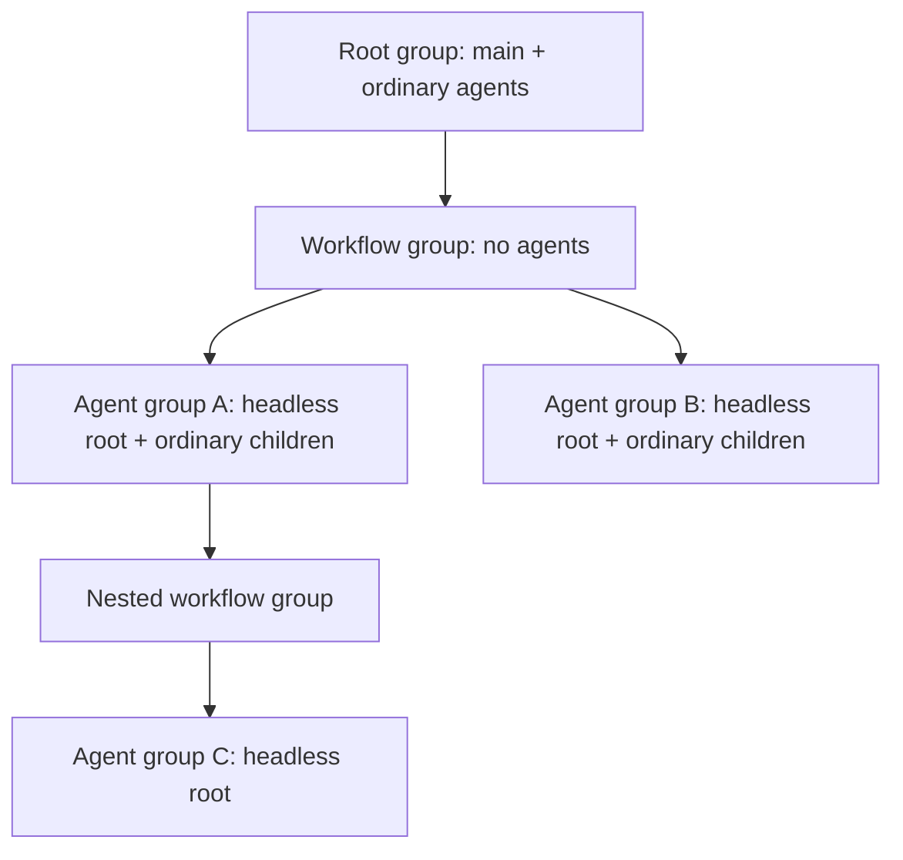
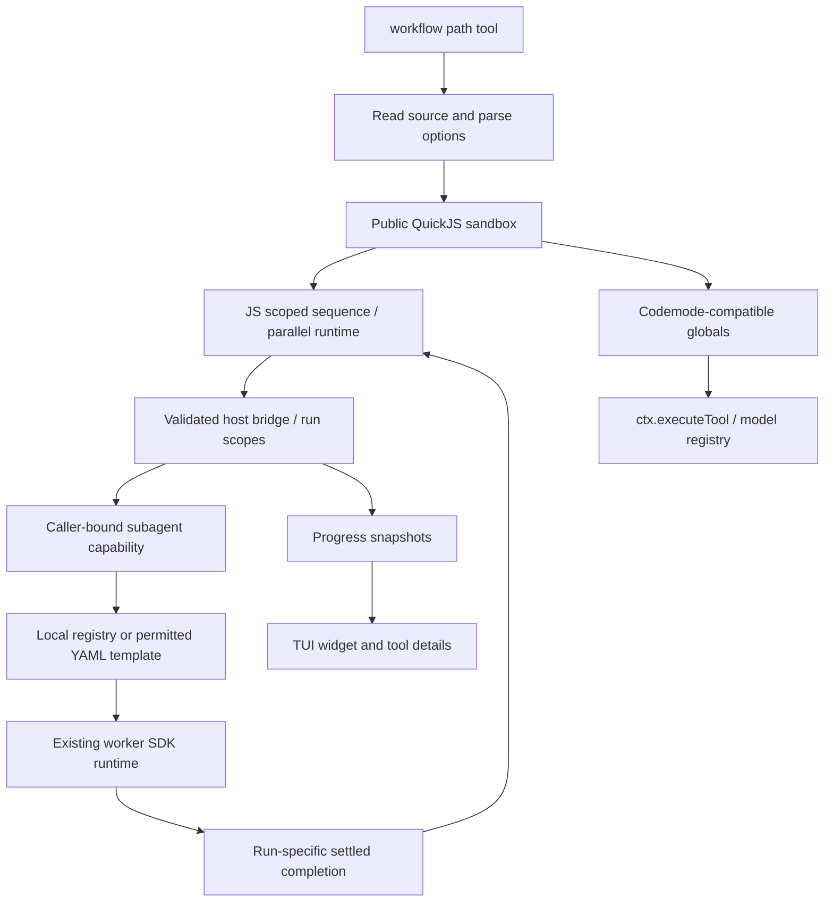

## Goal Description

Add **dynamic workflows** to this repository as a Pi extension under `pi/extensions/workflow/`.

The model-facing `workflow` tool accepts a JavaScript file path and executes its contents as an async function body in the **same QuickJS sandbox implementation used by codemode**. It retains codemode's tools, output, discovery, store, and non-LLM model facilities and adds workflow-specific orchestration helpers.

A workflow can register its own YAML-equivalent agent definitions, await an agent's final response, and compose asynchronous stages with sequence/parallel helpers. While executing in the TUI, a widget shows short progress labels, parallel fan-out, and each sequence's active and immediately previous stage.

Add **agent groups** as the isolation and viewer-navigation model. The main session and its ordinary subagents belong to the root group. Each workflow invocation creates a child workflow group, and each `workflow.agent()` call creates a separate child agent group whose root is a non-interactive worker. Ordinary children created by that root remain in its group. Agents can list/message only members of their own group; parent/child group relationships are for UI organization and never grant communication rights. `/groups` chooses which group's agents the viewer and bottom bar show.

**Status:** approved by the user and implemented. Final verification passed: 212 repository tests, including the subsequent per-group agent/group depth update, both extension type checks, and real native/fallback TUI smoke checks. See [walkthrough](walkthrough.md) for implementation details, evidence, and remaining limitations. The architecture/research sections below retain the original planning context.

### Confirmed requirements and clarifications

- Tool name: `workflow`; input: a path to a JS file, not inline code.
- `workflow.agent(prompt, template, optionalName)` starts a new uniquely named agent, awaits its completed run, and resolves to its final text as a string.
- Names use `(optionalName ?? template) + "-" + counter`; even an explicit name is a prefix, never an exact reused instance name.
- `workflow.register_agents(definitions)` accepts JavaScript objects with the same public fields, defaults, and validation rules as agent YAML.
- Registered workflow agents can be used without giving the calling agent normal `create_agent` permissions. This exception is confined to the workflow; it does not change ordinary child permissions.
- Existing YAML templates are also usable **when the caller already has permission**.
- Prefer workflow-defined agents and self-contained workflows in the skill; existing templates are an explicitly documented convenience, not the recommended default.
- `workflow.parallel` rejects on the first branch failure and cancels remaining sibling work.
- Composition signatures are functions-first with an optional label. Sequence/parallel progress nodes are **not** agent groups.
- Following the latest clarification, callbacks receive a **scoped workflow object**, rather than a separate `set_status` function:
  - Sequence: `(prior_result, workflow)`; the first prior result is `undefined`.
  - Parallel: `(workflow)`; no prior-result argument.
  - Both call `workflow.set_status("Short label")`.
- “Do not use unless directed” is a model-facing tool/skill rule, **not** a confirmation dialog. Direction may come from the user or an agent's configured instructions.
- All agents created through ordinary `create_agent` calls remain in the creator's agent group.
- Each workflow invocation creates a child group beneath its caller's group. Each `workflow.agent` call always creates its own child group beneath that workflow group, not a shared sibling-agent group.
- A workflow-launched agent is its group's root: `parentName: null`, headless worker role, no interactive permissions. Its workflow caller is an internal owner, not a visible messaging parent.
- A group root without child-template permissions receives none of `create_agent`, `list_agents`, `send_message`, or `wait_message`, even when explicitly named in tool defaults/extras. This rule applies to headless group roots as well as `main`.
- `workflow` remains separately selectable through normal loadouts; a leaf group root may still run a directed workflow.
- `list_agents(all: true)` means all agents in the caller's **own group**. Agent messaging cannot cross group boundaries, including ancestor/descendant groups.
- The bottom bar and agent cycling show only members of the current UI group. `/groups` selects a group from the hierarchy; `/subagents` selects an agent within it. Viewer selection does not change the actual running main session or a model's permissions.
- Shared-group launch options for multiple `workflow.agent` calls are deferred to a later version; do not add such a parameter now.

### Current architecture and research findings

| Area | Existing implementation | Consequence |
|---|---|---|
| Codemode | Pi 1.1.0 built-in extension; `@earendil-works/pi-codemode` 1.1.0 public sandbox package | Reuse the public sandbox; do not run workflow files with Node, `require`, or dynamic import. |
| Custom globals | Public sandbox supports injected host functions; host arguments/results cross a JSON bridge | Keep callback functions and composition inside QuickJS. Send only data across the bridge. |
| Built-in codemode | `createCodemodeExtension()` options do not offer custom globals; execution internals are not public SDK exports | Build a small compatibility adapter, rather than patching installed Pi or importing private `dist/` implementations. |
| Workers | `subagents/workspace.ts` owns creation, limits, lifecycle, membership, and messages; `runtime.ts` constructs restricted SDK sessions | Keep one workspace coordinator; add group membership and distinguish headless group roots from the sole interactive main session. |
| Permissions | `Workspace.create()` checks child allowlists; `list(all)` and `send` currently have workspace-wide reach; hiding communications for leaf roots currently depends on the literal name `main` | Add caller-group enforcement to coordination and replace name-based root-policy checks with actual group-root identity. |
| Group structure | Existing `Identity.parentName` serves ordinary parentage, completion and model inheritance; no group tree exists | Separate same-group agent parentage, UI group ancestry, and private run ownership/depth. Workflow roots have no messaging parent. |
| Completion | `agent_settled` computes final text and sends it as a parent message; startup acknowledgement is asynchronous | Add run-specific completion promises. Workflow-owned initial runs return privately to the workflow rather than injecting every answer into the caller's context. |
| Limits | Existing creation throws at `max_running`; waiting workers still reserve slots | Queue workflow requests when practical, without increasing workspace limits or changing ordinary `create_agent` behavior. |
| Restore/resume | Worker membership persists normalized template snapshots; idle resumes currently look up a global template | Persist workflow-local registry provenance, and use the saved local registry on resume. Never silently substitute a same-named global template. |
| UI | Existing bar, cycling, pickers and fallback overlay iterate all workspace records and special-case main | Add independent current-group view state and `/groups`; scope existing agent views/bar to that group while keeping main as the sole interactive session. |
| Loadouts | Repository `pi/settings.json` currently uses `defaultTools: ["+codemode"]` | Add `+workflow` so ordinary templates can select it through the existing default loadout. Restrictive templates/CLI overrides remain authoritative. |
| Skills | Repository skills live under `skills/`; installed skills are separately managed symlinks | Add a normal portable skill; document its installation rather than changing global skill-manager state automatically. |

Research included the relevant extension, codemode, TUI, skills, packages, settings, SDK, configuration, security, session-format and message-type documentation; the installed sandbox README/public declarations; widget/dynamic-tool/SDK examples; and this repository's subagent lifecycle, loadout, persistence, UI and deterministic test patterns. The agent-group revision additionally inspected workspace-wide list/send, name-based leaf-root gating, persisted delivery replay, native viewed-session selection/cycling, the bottom bar, and fallback overlay. Existing unrelated UI/cache and instruction-file changes in the working tree must be preserved during any later implementation.

## User Review Required

> [!IMPORTANT]
> **Callback API reflects the latest clarification.** The proposed API is `sequence([(prior, workflow) => ...], label?)` and `parallel([(workflow) => ...], label?)`, with `workflow.set_status(...)`. There is no separate `set_status` callback parameter. Approving this plan approves that simplified signature.

> [!WARNING]
> Workflow-local agent registration intentionally does not require the caller's child-template permissions. Agent definitions still determine their workers' tools/models/skills, and existing workspace limits and interactive-only restrictions still apply. This is a tool policy, **not an OS sandbox or a promise that worker capabilities are a subset of the caller's**. The JS VM itself has no direct filesystem/network/Node access; tools and worker sessions can have effects.

> [!IMPORTANT]
> Existing YAML templates require the caller's normal permission. Local definitions take precedence **inside their workflow registry only**. Registering a definition must not change the global template map, `/agent` choices, or normal `create_agent` permissions.

> [!IMPORTANT]
> Parallel cancellation stops scoped agents/tools/model calls and prevents further scoped calls. It cannot undo completed file changes or forcibly unwind arbitrary pure-JS code inside one callback without stopping the entire VM. Workflow callbacks must use their scoped `workflow` object for nested work. Root globals remain available for codemode compatibility, but are run-scoped, not implicitly branch-scoped.

> [!IMPORTANT]
> Proposed operational defaults: workflow tool is model-only and sequential; no runtime user-confirmation dialog; no automatic crash/reload restart; final worker text only (not thinking/tool output); `""` for a successful run without text; `sequence([])` resolves `undefined`; `parallel([])` resolves `[]`; source limited to 1 MiB; status labels limited to 80 characters and recommended to be 2–5 words. All new tool/host operation object schemas reject unknown fields.

> [!WARNING]
> Adding `+workflow` to `pi/settings.json` changes the default tool catalog, including workers using default tools. It does not instruct agents to invoke it automatically. The tool guideline is exactly **“Do not use workflow unless directed.”** Templates excluding default tools must opt in explicitly. The extension requires an active subagents workspace, but the caller may be a leaf template.

> [!IMPORTANT]
> **Agent groups are communication boundaries, not just labels.** Every workflow-launched agent is a headless root in its own group. `list_agents(all: true)` is group-local and cross-group `send_message` is rejected, even for the interactive main agent. Workflow results return through private host completion handles, not cross-group agent messages. The human UI can inspect the whole group tree without granting models that access.

> [!WARNING]
> This narrows existing workspace-wide `list_agents(all: true)` and messaging semantics when multiple groups exist. Main and all ordinary children still share the root group. An isolated workflow root cannot subsequently be resumed by main's `send_message`; only an authorized same-group sender or explicit internal/operator action can resume it. No new operator-resume UI is proposed, and viewer selection remains read-only.

> [!IMPORTANT]
> Root tool gating is based on being an **agent-group root**, not being named `main` or having an interactive role. Leaf non-root subagents retain their existing same-group communications. `workflow` is not one of the four workspace agent tools hidden from leaf roots, as confirmed with the user.

> [!IMPORTANT]
> The group tree is only a UI hierarchy. Private ownership still drives cancellation, usage attribution and workspace-wide limits across group boundaries. Creating a fresh group must not reset depth, free capacity artificially, or grant ancestor/sibling messaging. Shared-group workflow-agent launch is explicitly deferred.

## Open Questions

No blocking questions remain after the user's clarifications, including the confirmation that ordinary children stay in their creator's group and `workflow` has independent loadout policy.

The defaults above are proposals for approval. In particular, approve the simplified callback signatures, agent-group isolation and viewer behavior, private agent completion routing, empty-result behavior, limits, migration and installation strategy. Proposed `/groups` selection is described below, including how empty workflow containers appear and how Escape returns to the root group. Changes to these choices should revise this document before implementation.

Out of scope for v1: workflow execution CLI commands, separate input/argument files, ESM imports, checkpoint/restart of JS execution, distributed execution, retry policies beyond explicit script logic, editing/viewing workflow source in a new UI, global agent registration, and shared-group/multiple-root options on `workflow.agent`. `/groups` is an in-scope human viewer command, not an execution or model-facing tool. Workflow files are deliberately ordinary codemode-style async bodies, not ES modules.

## Proposed Changes

### 1. Public API and shared workspace capability

#### [NEW] `pi/extensions/shared/workflow-agents.ts`

Define a versioned, typed in-process capability request similar to `shared/viewed-session.ts`. A workflow extension requests the capability through its own session's `pi.events`; the subagents root or worker inline factory provides a service already bound to the actual caller identity.

The script never supplies a parent name, group ID, workspace ID, or permission-bypass flag. The bound service creates the workflow container under the caller's group and one isolated agent group per `agent()` invocation. Group membership cannot be selected by script arguments in v1. Capabilities cannot be cached across reload/session replacement.

Illustrative host contract:

```ts
interface WorkflowAgentCompletion {
  name: string;
  text: string;
  usage?: Usage; // Pi's normal usage shape; private to the adapter
}

interface WorkflowAgentRun {
  readonly id: string;
  registerAgents(definitions: unknown[]): Promise<void>;
  agent(prompt: string, template: string, name: string | undefined,
        signal: AbortSignal): Promise<WorkflowAgentCompletion>;
  close(reason?: string): Promise<void>;
}

interface WorkflowAgentsAPI {
  readonly version: 1;
  openRun(options: {
    sourcePath: string;
    signal: AbortSignal;
  }): WorkflowAgentRun;
}
```

The names above are design sketches, not a promise to expose host implementation details as script globals.

#### [MODIFY] `pi/extensions/shared/README.md`

Document capability discovery, caller/group binding, lifecycle invalidation, and the distinction between workflow-local template authority, communication-group membership, UI group ancestry, and private ownership.

---

### 2. Reusable template validation and local registries

#### [MODIFY] `pi/extensions/subagents/templates.ts`

Extract object normalization from YAML parsing, keeping current YAML syntax/size/tag/alias checks and discovery behavior intact:

```diff
 export function parseTemplate(text: string, source: string): Template {
   // Existing YAML size, document and alias validation remains here.
   const raw = document.toJS({ maxAliasCount: 32 });
+  return normalizeTemplate(raw, source);
+}
+
+export function normalizeTemplate(raw: unknown, source: string): Template {
   const data = object(raw, ["name", "selectable", "model", "tools",
                             "skills", "prompt", "subagents"], source);
   // Existing field validation and normalization.
 }
```

Object definitions accept the public fields `name`, `selectable`, `model`, `tools`, `skills`, `prompt`, and `subagents`, including legacy `subagents.allowed` rules. They do not accept internal `source` or already-normalized permission metadata.

Relative `skills.extra_paths` resolve relative to the workflow JS file, just as YAML paths resolve relative to the YAML file. Task/template bounds and name validation remain consistent with existing subagents.

#### [NEW] `pi/extensions/subagents/workflow-agents.ts`

Implement the workflow-local registry and bound capability service:

1. Create a new isolated registry for each invocation.
2. Validate a registration batch atomically against the current registry plus the entire new batch, allowing mutual/forward references within that batch.
3. Reject duplicate names, missing references, unknown fields, invalid values, over-size definitions, and malformed graphs without partial registration.
4. Definitions are immutable once registered. Later batches may add new names, but do not replace existing definitions.
5. Proposed caps: 128 definitions and 1 MiB total serialized definitions per run; retain the existing 128 KiB individual-definition bound.
6. Local child references resolve within the registry. Explicit references to global templates must be in the invoking caller's allowed global-template set. `subagents.include_defaults: true` expands the local catalog plus permitted global templates, not every globally discovered template.
7. A local definition shadows a same-named global definition within this registry only.
8. Keep `selectable` validation/defaults, but never publish local templates into `/agent`.
9. `agent` requires an explicit template string; it does not silently use the caller's default child.
10. Reserve unique instance names synchronously across the workspace, skipping occupied counters, including after restore. Preserve workspace-unique names in v1 even though lookup/list permissions are group-local; no name-collision/multiple-namespace API change is required. Validate the requested prefix; shorten a valid long prefix only as needed to fit the numeric suffix within the existing 64-character instance-name limit.
11. Keep registration ephemeral for the caller. Persist immutable registry snapshots only as provenance needed by created workers and their allowed local descendants.
12. Create a workflow container group once per invocation, then a distinct member-bearing agent group for each agent request. Registering the same templates for multiple agents shares definitions only, not membership, agent identity, messages, or context. Each launched agent has `parentName: null` and role `worker`; authorized ordinary children join its group.

**Permission resolution:**

| Requested template | Resolution |
|---|---|
| Registered in this run | Allowed through the run capability, regardless of caller child permissions |
| Existing YAML template, caller allows it | Allowed using normal template permission semantics |
| Existing YAML template, caller does not allow it | Reject |
| Local name belonging to another run | Reject unless independently registered in this run |
| Expired caller-side registry after tool completion | Not available to future scripts or ordinary caller creation |

---

### 3. Workspace creation, completion, scheduling, and persistence

#### [MODIFY] `pi/extensions/subagents/workspace.ts`

Factor the common worker construction from `create()` into a private resolved-template path. Ordinary `create()` continues to validate the parent allowlist and place the new worker in the parent's group before using it. The workflow service creates a new agent group with a headless root and uses the local-template capability path; no model-facing tool gets an arbitrary template, group or bypass parameter.

Keep same-group `parentName` separate from a private ownership record containing the creating caller/run, inheritance source and effective creation depth. Workflow roots have `parentName: null`, but still inherit `model: parent` from their launching caller and still consume workspace-wide worker capacity, with independent local-agent and agent-group depth checks. Root-ness never implies interactivity. **Updated depth policy:** `max_depth` now applies independently within each group (roots at depth 0), and `max_group_depth` bounds nested agent groups (workspace root at 0; workflow containers do not count). This replaces the original cross-group creation-depth limit.

Add **per-run completion handles**, not polling `wait_message`:

- Install the completion handle and routing policy before starting the worker task.
- Key completion by instance and worker run ID; use `agent_settled`, not first `message_end` or `agent_end`.
- Resolve with the final assistant text blocks joined by newlines; exclude thinking and tool-call content.
- Resolve `""` if there is no final text; reject startup, provider, interruption, workspace-close and cancellation failures.
- Do not select an intermediate assistant response or a response from a later resumed run.
- Ensure completion settles exactly once, even if run rejection and `agent_settled` both occur.
- For workflow-owned initial runs, deliver final text only through the completion handle. Do not also call the current automatic parent-report path.
- Keep ordinary agents' parent messages within their own group. Preserve ordinary root-group messaging behavior; evaluate message-wait deadlock using eligible same-group progress and explicit host dependencies rather than unrelated running agents in other groups.
- A workflow root has no messaging parent in **any** run. Never resume or report to the launching caller using cross-group messages. Ordinary descendants can still report to their same-group parents. Later authorized same-group resume does not reinstate a hidden external parent; only an explicit host completion owner can receive a resumed root's result.
- Adjust the workflow root's prompt to accurately say that it is a non-interactive group root, has no messaging parent, and its owned task response returns to the workflow. Do not disclose other groups' agent identities or internal ownership links.
- Agent failures must carry the generated name and template in their error text so scripts can report useful failures.

Cancellation must bind to the actual started run, not just startup:

- Abort queued acquisitions and worker setup where possible.
- Abort active owned worker sessions and stop owned descendants started for that task; never cancel unrelated workspace agents.
- Track ownership through ordinary descendant creation as well as workflow helper calls so aborting a parent does not orphan its task descendants.
- Await idempotent cleanup of owned active work. Preserve stored transcripts and idle/error/interrupted records for inspection.
- A successfully completed agent may remain idle and viewable by selecting its group through `/groups`, then `/subagents`; a workflow does not reuse that instance or group for a second `agent()` call.
- Ownership traversal may cross agent-group boundaries for cancellation only; it must not reuse model-facing group-local message/list methods or grant messaging access to the cancelled subtree.

**Capacity scheduling:** introduce a cancellable FIFO acquisition path for workflow requests. Creation still reserves a slot synchronously before awaiting setup. Recheck capacity after wakeups and racing ordinary creates. Queue excess workflow fan-out rather than failing merely because `max_running` is reached; ordinary `create_agent` retains its current immediate limit error.

No new scheduler may evade `max_running`, per-group `max_depth`, or `max_group_depth`. Capacity is workspace-wide across all agent groups. Agent depth resets to 0 at each group's root; agent-group depth follows ancestry across workflows. Visual workflow containers do not occupy worker slots or increment either depth. Track workflow-awaiting worker owners so nested workflows with every slot reserved by waiting parents fail with an actionable capacity/deadlock diagnostic, rather than waiting forever. Cancellation, startup failure, workspace close, and terminal status release/wake queued requests.

#### [MODIFY] `pi/extensions/subagents/types.ts`

Add agent-group membership, group descriptors, workflow provenance and completion ownership to records/membership, with internal run-result types. Group roots are worker or interactive identities with no same-group parent; only the main session has role `interactive`. Do not overload role with a new `root` value or break `shared/agent-role.ts` worker detection.

Keep old identity/membership entries readable. Missing group metadata in genuine pre-group entries migrates to the root group; missing or corrupt metadata on a newly group-tagged entry must fail closed, not merge an isolated agent into the root group. Missing workflow provenance still means normal global-template behavior only for ordinary legacy records.

#### [MODIFY] `pi/extensions/subagents/persistence.ts`

Add a versioned non-context registry/provenance entry, for example `subagents.workflow-registry.v1`, keyed by registry ID. Persist immutable definitions before members reference them; store the relevant registry in worker history as well as workspace history where reconstruction requires it.

Validate restored data rather than trusting arbitrary session JSON. Registry snapshot sizes, names, references and source paths receive the same normalization rules as initial registration. Persist versioned group descriptors/membership and private ownership as specified in section 3a below; do not reconstruct isolation by reading the workflow JS file.

#### [MODIFY] `pi/extensions/subagents/index.ts`

Provide the bound interactive-main capability request handler. Resolve the current workspace at request time; invalidate it on tree navigation, reload, new/fork/session replacement and shutdown. A leaf main template can obtain the workflow capability if its loadout includes `workflow`, even though ordinary workspace agent tools stay hidden. Initialize the root agent group before applying loadouts. Register the human `/groups` command and connect group-view selection to the bar, agent picker, cycling and overlay.

#### [MODIFY] `pi/extensions/subagents/runtime.ts`

Provide an equivalent caller/group-bound capability handler in each worker's inline factory. Use the shared coordinator rather than creating another workspace inside workers; a worker may nevertheless be the **root of its own agent group**. Keep the workflow extension loadable in headless workers and keep existing selected-tool/interactive-only guards. Root tool exposure must use group-root status, not the agent's name or role.

On explicit idle resume, a workflow-created worker resolves its template and local child graph from validated saved provenance, not `workspace.templates`. Global workers continue to use refreshed discovered templates as today. A restored workflow worker must not become an unrestricted global worker merely because the local JS file or a same-named YAML file changed.

#### [MODIFY] `pi/extensions/subagents/loadout.ts`

Make prompt identity accurate for headless group roots, group-local communications, workflow-managed completion and local child permissions. Replace the literal `name === "main"` leaf-root test with `isGroupRoot`. Preserve normal loadout filtering; do not introduce a blanket exception that makes `workflow` callable to a template excluding it.

---

### 3a. Agent groups: isolation, persistence and human navigation

#### [NEW] `pi/extensions/subagents/groups.ts`

Introduce a workspace-owned graph of **agent groups**, separate from the per-group ordinary agent-parent tree and the private task-ownership graph. Every agent belongs to exactly one group. An agent group may have child groups; those relationships organize the human viewer only.

Illustrative data model:

```ts
interface AgentGroup {
  version: 1;
  id: string;                     // stable opaque ID, not its label
  parentGroupId: string | null;
  kind: "root" | "workflow" | "agents";
  label: string;
  rootAgentInstanceId: string | null; // null for a workflow container
  workflowRunId?: string;
}

// Added to persisted identity/membership through backward-compatible decoding:
interface GroupMembership {
  groupId: string;
}

// Private provenance, not emitted by model-facing list_agents or promptIdentity:
interface AgentOwnership {
  ownerInstanceId?: string;
  ownerRunId?: string;
  creationDepth: number;
  inheritanceSourceInstanceId?: string;
}
```

Groups are not independently running sessions. A workflow container has no agent root and no agents in v1; it has children containing the launched agents. The member-bearing root group has main as its root; each member-bearing workflow-agent group has the launched worker as its root. The kinds distinguish viewer presentation, not different cross-group communication privileges.

**Concrete hierarchy:**

```text
Root group
├─ main                         interactive group root
├─ ordinary-worker              created by main; same group
└─ Workflow: Repository overview empty organizational group
   ├─ Agent group: researcher-1
   │  ├─ researcher-1           non-interactive group root
   │  ├─ helper-1               ordinary child, if root permits it
   │  └─ Workflow: Follow-up    nested organizational child group
   │     └─ Agent group: analyst-1
   │        └─ analyst-1        another isolated headless root
   └─ Agent group: conventions-1
      └─ conventions-1          isolated from researcher-1 and main
```



There are no communication edges between the boxes. `sequence` and `parallel` create progress/composition nodes only; they do not create agent groups. Private workflow completion handles and cancellation ownership are host mechanisms, not agent messages or public parent links.

**Creation and lifecycle:**

- Create one root group for a newly launched main workspace; assign every ordinary descendant to the creator's current group.
- Open one workflow container when a workflow invocation is accepted; attach it to its caller's agent group, regardless of whether that caller is a root or ordinary child.
- Reserve one child agent group per `workflow.agent` call. The reservation can show queued state; create its worker root when capacity becomes available. Store terminal status/error for failed launches so the viewer can explain an empty failed/queued group.
- Each workflow launch remains isolated even when it uses an existing permitted YAML template or the same registered template as another launch.
- Keep finished groups and idle workers available for read-only inspection. Never auto-share groups, collapse membership into the parent, or reuse a previous group on a subsequent launch.
- Parent group pointers must stay within the workspace; validate IDs, acyclicity, root/member consistency and allowed cardinality. In v1 there is at most one agent root per member-bearing group and no members in workflow containers.
- Group boundaries are tool-level communication/context boundaries, not filesystem, credential, process or network isolation. Workers may still access shared files through their selected tools.

#### [MODIFY] `pi/extensions/subagents/tools.ts`
#### [MODIFY] `pi/extensions/subagents/workspace.ts`
#### [MODIFY] `pi/extensions/subagents/loadout.ts`

Enforce these invariants at both exposure/loadout and coordinator-operation layers, including nested tool calls and late registrations:

```ts
const GROUP_AGENT_TOOLS = [
  "create_agent", "list_agents", "send_message", "wait_message",
];
const hideGroupAgentTools = isGroupRoot(identity) &&
  template.subagents.allowed.length === 0;

// Internal message policy, before queuing/persisting/delivering anything:
if (sender.identity.groupId !== target.identity.groupId) {
  throw new Error("Agent is not available in your group");
}
```

- Leaf group roots receive none of the four tools, even through defaults, explicit extras, codemode discovery or nested invocation. Hide their snippets/guidelines too. `create_agent` stays unavailable to **any** agent whose template has no children; leaf non-root agents retain same-group communications as before.
- `workflow` remains independent: selected leaf group roots can invoke it, create registered agents in new isolated groups and receive the helper result string.
- `list_agents()` returns direct same-group children as today; `all: true` returns all agents in the caller's own group, including its root and idle members, never descendants of child groups. The description changes from “whole workspace” to “your agent group.”
- `send_message` validates same-group membership even when the caller knows an exact workspace-unique external name. Unknown and external names should produce the same public unavailable-target error, without exposing an external target's state or template. No group selector or bypass field is added to tools.
- Ordinary completion messages require a same-group parent. Group roots cannot automatically report to an owner in another group. Explicit workflow return values are unaffected.
- Persisted/pending delivery replay must revalidate group equality before context injection, not just validate the original send. Reject corrupt cross-group envelopes rather than importing them into a new or restored group.
- `wait_message` must not consume cross-group envelopes; local deadlock detection cannot be kept alive just because an unrelated group has a running agent. Track legitimate host-owned workflow dependencies separately from model messaging.
- Agents' prompts/list output contain only their own group identity and same-group agent-parent relationships. Do not advertise the human group tree, other roots, or private owner identities as visible peers.
- Use caller-relative restricted lookups for model operations; keep global record lookup only for trusted internal coordination/viewer paths. Human `/groups` access does not change the caller used by any model tool.

#### [MODIFY] `pi/extensions/subagents/persistence.ts`

Persist versioned non-context group entries, for example `subagents.group.v1`, and membership/ownership snapshots before worker startup acknowledgement. Include enough membership identity in each worker history for headless root classification and reopening a worker session without granting interactive tools.

Backward compatibility and restore:

- Legacy workspaces with no group metadata get one root group containing main and all legacy ordinary workers, preserving their existing same-workspace communications.
- Distinguish genuinely legacy entries from new group-tagged entries. Missing group references, multiple roots, cycles, wrong-workspace references or mismatched worker identity are errors, not permission-broadening fallback.
- Reconstruct groups and membership from the active branch before deliveries, loadouts or UI selection are restored. Tree navigation cannot merge abandoned groups into the current group.
- Retained workflow-root membership stays isolated after reload; it does not acquire main as a messaging parent. Missing JS/global template changes do not alter saved group membership/local definitions.
- New/forked workspaces receive their own root/group identities following existing workspace isolation; do not attach groups to another workspace's files. Retained in-process ephemeral histories use the same membership checks.
- No tasks resume automatically. An isolated leaf root can be inspected but not resumed via cross-group `send_message`. Testing explicit resume uses an authorized same-group sender or a deliberate trusted-host fixture, not a new model-facing bypass or interactive viewer.
- UI group selection is ephemeral; reset to the active workspace root on reload/new/fork/tree/shutdown instead of persisting stale navigation references.

#### [NEW] `pi/extensions/subagents/group-selection.ts`
#### [NEW] `pi/extensions/subagents/group-view.ts`
#### [MODIFY] `pi/extensions/subagents/index.ts`

Maintain human navigation state independently from the actual session: `currentGroupId` and an optional last-viewed agent per group. Changing this state never changes model identity, active tools, permissions, run ownership or the main session's prompt target.

Add `/groups [id|root]`:

- Without arguments, open a native picker containing the group tree, root-first and indented by ancestry. Include friendly labels, stable short IDs, direct member count/status, and empty workflow containers; names/labels are display data, not unique identifiers.
- With a stable group ID select directly; `root` returns to the root group. Complete stable IDs with descriptive labels. Picker cancellation is a no-op; stale results after workspace replacement are ignored.
- Selecting a member-bearing group displays its remembered valid agent, otherwise its root, through the existing read-only viewed-session API. Selecting the root group's main restores the ordinary main transcript.
- Selecting an empty workflow container clears the old worker transcript and uses `group-view.ts` to show a lightweight read-only overview with child-group entries and status, using the existing UI integration or a simple overlay rather than creating a dummy agent/session. Its bottom bar shows the selected group label and “No agents”; no child agents are flattened into it. `/groups` can then choose a child member-bearing group. Handle queued/failed member-bearing groups whose root has not started with the same safe empty/overview path.
- Without compatible viewed-session support, `/groups` still sets the current group and uses the existing overlay path for that group's agents/overview. There is no interactive takeover of a worker.
- In print/JSON/RPC modes, return a human-oriented group-tree listing through the existing mode-appropriate command channels; do not invent a model-callable list-groups tool or emit terminal widgets. TUI view-state selection is not a cross-group model permission.

#### [MODIFY] `pi/extensions/subagents/selection.ts`
#### [MODIFY] `pi/extensions/subagents/agent-bar.ts`
#### [MODIFY] `pi/extensions/subagents/view.ts`

- The bottom bar shows a short current-group breadcrumb/label and **only direct member agents** of that group, including idle members. Group descendants are not agents in the current group.
- Alt+] / Alt+[ cycle only current-group members; empty groups are a no-op. Highlight the agent actually being viewed, never main merely because a non-root group's selection is absent.
- `/subagents` picker, explicit name lookup and completions use the current UI group. An out-of-group explicit name tells the human to select its group with `/groups` rather than silently navigating across groups. `/subagents main` remains an explicit reset to root/main for compatibility.
- The fallback overlay starts at the selected group's root/remembered member and filters agent tabs, idle counts and rendered parent details to that group. Empty containers have a safe overview/empty state; never dereference a nonexistent `main` record inside a group.
- Escape restoring main also restores the current group to root, including when the UI restores main independently. Synchronize selection/bar state through existing viewed-session change notifications. The actual input/session remains main throughout.
- Recheck group membership after async picker results, resume/reconstruction and group/view changes. Dispose subscriptions and clear remembered references at lifecycle invalidation.
- Cache group-tree/menu/layout and bar/overview rendering where useful. Invalidate on membership/status/content/group selection/width/theme changes, respecting the current repository guidance about spinner-triggered redraws and bounded caches.

The human viewer is intentionally allowed to traverse all groups. This does not let the currently running main model send messages to an inspected workflow root.

---

### 4. Codemode-compatible file execution adapter

#### [NEW] `pi/extensions/workflow/package.json`
#### [NEW] `pi/extensions/workflow/package-lock.json`
#### [NEW] `pi/extensions/workflow/.gitignore`

Declare the public `@earendil-works/pi-codemode` sandbox as a direct runtime dependency pinned initially to `1.1.0`, rather than assuming Pi supplies its transitive dependency to extensions. Pi-provided SDK, agent-core, ai, TUI, and TypeBox remain peers. Include local test/type-check scripts; ignore `node_modules`.

Do not install another physical copy of Pi's host SDK. Follow the existing dependency-install pattern with peer auto-install suppressed.

#### [NEW] `pi/extensions/workflow/index.ts`

Register a strict path-only tool:

```ts
pi.registerTool({
  name: "workflow",
  label: "Workflow",
  exposure: "model-only",
  executionMode: "sequential",
  description: "Run a JS workflow file in the codemode sandbox with workflow helpers. Do not use unless directed.",
  promptSnippet: "Run a directed JavaScript workflow file",
  promptGuidelines: [
    "Do not use workflow unless directed.",
    "Read the dynamic-workflows skill before authoring or changing workflows.",
  ],
  parameters: Type.Object({
    path: Type.String({ minLength: 1, description: "JS file path, relative to cwd or absolute" }),
  }, { additionalProperties: false }),
  // execute, renderCall and renderResult delegate to the modules below.
});
```

Model-only exposure keeps orchestration directly callable when selected but prevents recursive calls through `tools.workflow` or codemode. Both `workflow` and `codemode` are excluded from the workflow sandbox's callable tools. Agents may start their own directed workflow through their selected model-facing tool, subject to workspace nesting/ownership rules.

File handling:

- Resolve relative paths against `ctx.cwd`, and support normal leading-`~` expansion.
- Require a readable regular `.js` file; allow symlinks to regular files; do not impose an unrequested project-path allowlist.
- Read the file once, with the proposed 1 MiB bound checked on the opened file/read contents.
- Include the resolved source path in details/errors. Do not silently execute a truncated read result.
- Keep ordinary tool cwd unchanged; only workflow-relative resources use the JS directory.
- Parse the codemode `// @options:` line before adding bootstrap source.
- Require a bound workspace capability for agent helpers; fail clearly if the subagents integration is absent. Do not silently spawn unmanaged sessions.

#### [NEW] `pi/extensions/workflow/codemode-adapter.ts`

Use public `CodemodeSandbox`, source parsing, declaration rendering, and sandbox output/store limits. Build tool adapters from the caller's `ctx.tools` and call them exclusively through `ctx.executeTool` so validation, hooks, permissions, nested IDs and usage remain intact.

Preserve codemode semantics:

- Async function body, top-level await/return, no Node/filesystem/network/timers/module imports.
- `tools`, `text`, `image`, `console`, `exit`, `store`, `load`, `ALL_TOOLS`, `searchTools`, `describeTool`, `describeNamespace`, and `models`.
- Structured output schemas/MCP return behavior; otherwise textual tool results; errors reject as they do in codemode.
- Tool descriptions/guidelines and namespace discovery apply only to permitted callable tools.
- `models` uses host-resolved provider/id, strips credential-bearing headers from catalog results, limits classifier/image concurrency to four, propagates cancellation, and accounts for usage. Never trust script-provided endpoint/header fields with host credentials.
- 256 MiB heap, no default deadline, source-option hard deadlines, output/store caps from the public sandbox.
- Final return value appended like `text`; preserve partial output on failure and use `isError: true`.
- Default output budget 10,000 tokens with start/end truncation and a full-output temp-file path; save shown images with path labels.
- Successful store writes append normal branch-relative `codemode-store` entries; failed runs do not commit. Workflow and codemode intentionally share the session store.
- No unawaited agent/tool calls left running after success, failure, `exit`, abort, or timeout.
- Correct source-line mapping after adding the workflow bootstrap. Keep a wrapper line-offset map and translate QuickJS stack frames, including failures caught and rethrown through composition, instead of exposing bootstrap line numbers as source lines.

Some formatting/discovery glue must be implemented locally because Pi's execute helper is private. Keep it isolated in this adapter, note the Pi version, and add compatibility tests rather than claiming to reuse the built-in tool itself. Do not change installed Pi files.

Usage returned by awaited agent runs is accumulated once on the workflow tool result; nested `ctx.executeTool` usage is already added by Pi and must not be manually counted a second time. Count cancelled/failed agent work too. Use per-run session usage deltas, including nested workflow tool usage, rather than summing complete historical worker totals or double-counting a nested workflow's descendants.

---

### 5. Scoped composition and cancellation

#### [NEW] `pi/extensions/workflow/runtime-source.ts`
#### [NEW] `pi/extensions/workflow/run.ts`
#### [NEW] `pi/extensions/workflow/types.ts`

Keep orchestration callbacks inside QuickJS. A generated/bootstrap JS runtime constructs frozen workflow facades; a host bridge accepts strictly validated data operations, owns controllers and agent capabilities, and publishes node snapshots.

Proposed script contract:

```ts
interface Workflow {
  agent(prompt: string, template: string, name?: string): Promise<string>;
  register_agents(definitions: AgentDefinition[]): Promise<void>;
  sequence<T = unknown>(
    stages: ((prior: unknown | undefined, workflow: Workflow) => Promise<unknown>)[],
    label?: string,
  ): Promise<T | undefined>;
  parallel<T = unknown>(
    branches: ((workflow: Workflow) => Promise<T>)[],
    label?: string,
  ): Promise<T[]>;
  set_status(label: string): Promise<void>;

  // Scoped counterparts of the normal codemode globals.
  // Use these inside callbacks so cancellation belongs to their branch.
  readonly tools: typeof tools;
  readonly models: typeof models;
}
```

`set_status` acknowledges the host update asynchronously; examples await it. Registration is likewise awaited before creating agents. JS callback results pass directly between stages inside the VM, preserving `undefined` without a JSON round trip; only host operation data is serialized.

**Sequence behavior:**

1. Validate array/function arguments and optional label before starting anything.
2. Allocate one sequence composition node and one scoped stage for each callback, in supplied order. These are progress nodes, not agent groups.
3. Invoke the first callback with `undefined`; pass each resolved result to the next.
4. Return the last result; empty sequence returns `undefined`.
5. Stop before subsequent stages on failure/cancellation. Mark untouched stages skipped. Do not create a reserved agent group for a helper call that is never reached.
6. Retain the final label of the immediately preceding completed stage alongside the current stage label; a status change within one stage is not a new stage.

**Parallel behavior:**

1. Validate the entire callback list before starting it.
2. Start all callbacks with distinct scopes; workspace agent acquisition may queue actual agent starts.
3. Successful results retain input order, not finish order; empty parallel returns `[]`.
4. On the first failure, record that error, cancel sibling scopes and descendant owned work, await host cleanup, and reject with the original branch error plus short branch/composition context. Preserve any allocated agent groups as terminal inspection entries; they do not join another group on cancellation.
5. Observe every callback rejection so cancelled siblings do not produce unhandled errors.
6. A cancelled facade rejects further agent/tool/composition/status operations. Ignore late status events from already finished nodes.
7. Scripts can catch the rejected parallel operation and continue using the still-live parent scope for fallback work. Cancellation does not permanently abort the parent run unless the failure is uncaught or the run itself is aborted.

Scoped facades make nested hierarchy explicit without relying on a shared mutable “current stage,” Promise monkeypatching, or async-local context unavailable in QuickJS. Root globals are deliberately root-scoped. The skill directs callbacks to use their supplied facade for all external work and to await every operation.

Host bridge IDs must belong to the current invocation and to an issued scope; reject unknown/cross-run IDs and operations on closed scopes. Host script bridges are not separately registered model-callable Pi tools and do not expose a caller-selectable permission bypass.

**Execution structure:**



#### Example self-contained workflow

```js
// @options: {"max_output_tokens": 2000}
await workflow.register_agents([
  {
    name: "researcher",
    tools: { include_defaults: false, extra: ["read"] },
    prompt: "Inspect the assigned files. Return concise findings with paths.",
    subagents: { include_defaults: false },
  },
  {
    name: "summarizer",
    tools: { include_defaults: false, extra: [] },
    prompt: "Summarize the supplied findings. Do not make file changes.",
    subagents: { include_defaults: false },
  },
]);

return await workflow.sequence([
  async (_prior, w) => {
    await w.set_status("Research files");
    return await w.parallel([
      async branch => {
        await branch.set_status("Read architecture");
        return await branch.agent("Read README.md and summarize architecture.", "researcher");
      },
      async branch => {
        await branch.set_status("Read conventions");
        return await branch.agent("Read AGENTS.md and summarize conventions.", "researcher", "conventions");
      },
    ], "Research");
  },
  async (findings, w) => {
    await w.set_status("Summarize findings");
    return await w.agent(JSON.stringify(findings), "summarizer");
  },
], "Repository overview");
```

Defaults/model inheritance are the same as YAML. The example supplies explicit tasks and does not rely on its agents knowing the caller's conversation. It does not assume every registered agent's default tools are automatically least-privilege.

---

### 6. Progress state and rendering

#### [NEW] `pi/extensions/workflow/progress.ts`
#### [NEW] `pi/extensions/workflow/widget.ts`
#### [NEW] `pi/extensions/workflow/render.ts`

Maintain a plain, serializable progress tree keyed by invocation/node ID, with composition kind, label, status, child order, active stage, previous completed stage, associated agent name/group ID, and timestamps/duration. This tree is separate from agent-group membership/navigation; sequence/parallel nodes do not create communication groups. Do not put task prompts, final answers, or model thinking into status labels/widget nodes.

States: pending/queued/running/completed/failed/cancelled/skipped. Internal state may use more precise phases, but rendered meanings must remain stable.

Install an above-editor widget with a unique workflow-owned key while runs are active in a TUI. The below-editor agent strip keeps its placement but is now scoped to the selected agent group, as specified in section 3a. Private workspace progress aggregation makes workflows launched by headless workers visible to the human main TUI, attributed to the owning agent/group; it does not publish other groups to agents' list/message tools. Multiple owners/runs must not overwrite each other. The progress widget may show the human an active workflow's isolated branches even while the bottom bar remains confined to the selected group.

Conceptual rendering during the first example stage:

```text
Workflow · Repository overview
└─ Sequence 1/2 · active: Research files
   └─ Parallel · Research
      ├─ ● Read architecture · researcher-1
      └─ ● Read conventions · conventions-1
```

During its second stage:

```text
Workflow · Repository overview
└─ Sequence 2/2 · previous: Research files
   └─ ● Summarize findings · summarizer-1
```

Rendering requirements:

- Parallel groups show a labeled row per visible branch with fan-out connectors and queued/running/terminal state.
- Sequences show current and immediately previous stage labels; do not expand all historical stages by default.
- Unlabeled callbacks start as `Stage N` or `Branch N`, then use the latest short `set_status` label.
- Support nested groups, narrow terminals, CJK/wide characters, resizes, theme changes, and control-sequence stripping.
- Use Pi TUI width/wrapping utilities, never raw string lengths for terminal layout.
- Keep the widget compact: bounded visible rows (proposed 12), an omitted-branch summary, and the complete bounded tree available in expanded tool details. Proposed maximum 10,000 progress nodes per invocation; reject excessive composition rather than growing unbounded memory/session data.
- Coalesce repaint requests. Store unstyled data so theme invalidation is correct. Cache unchanged progress layout/rendering across spinner redraws; invalidate for node mutations, group/view context, width and theme changes, with bounded caches and reuse/invalidation regression tests.
- Publish progress as tool `onUpdate` details as well as the widget. Terminal results keep a final snapshot usable after reload/HTML export; not every status update needs its own persisted entry.
- Remove the live widget when no workflow is running, while retaining final tool rendering. Clear subscriptions/widgets on all lifecycle invalidation paths.
- Print/JSON/RPC execute the same runtime without terminal widgets or arbitrary stdout writes; progress flows through normal tool update/result channels.

#### [MODIFY] `pi/extensions/ui/custom-tools.ts`
#### [MODIFY] `pi/extensions/ui/custom-tools.test.cjs`

Add a concise `workflow` summary showing the source path and final/partial state in custom compact/emphasis views. Do not duplicate large answer bodies in widget summaries or modify unrelated transcript architecture. The normal registered tool renderer remains authoritative in standard Pi/exports.

---

### 7. Skill, configuration, and documentation

#### [NEW] `skills/dynamic-workflows/SKILL.md`

Use portable skill frontmatter:

```yaml
---
name: dynamic-workflows
description: Author or run directed JS workflows using the workflow tool, workflow-local agents, and scoped sequence/parallel composition.
---
```

Cover:

- **Do not use workflow unless directed.** Direction can come from user instructions or the agent's configured prompt. This is not limited to explicit user approval dialogs.
- Read/review the workflow before running unfamiliar code; sandboxed orchestration can still invoke tools and worker actions.
- JS async-body syntax and source options; no ESM/Node/import/timer APIs.
- `workflow({path})` tool usage, path/cwd behavior, and source-relative skill resources.
- Await registration; use workflow-defined agents for all normal workflow roles, with self-contained definitions and explicit tasks/inputs/expected outputs.
- Existing YAML templates are supported only when permitted, and should be exceptional to self-contained authoring.
- Agent YAML-equivalent fields/defaults, appropriate tool/skill loadouts, leaf-agent defaults, and model inheritance from the launching caller even though a launched agent is a headless group root.
- Every `workflow.agent` creates a separate isolated agent group. Sibling workflow agents and the caller are not messageable/listable peers; communicate data through task inputs, returned strings and sequence/parallel results instead. Ordinary children of a permitted root stay within its group.
- Leaf group roots receive no create/list/send/wait agent tools. `workflow` is separately selectable, not a substitute cross-group messaging permission. Agent groups do not isolate shared files or undo effects.
- Shared-group launch options do not exist in v1; do not invent a group argument. The human can select groups with `/groups` and agents within the selected group with `/subagents`, without changing model permissions.
- Use `sequence` for dependencies and `parallel` for independent work; prefer these over ad hoc Promise composition so progress and cancellation are visible.
- Callback signatures from this plan; use the supplied scoped facade for nested groups, agents, tools and models.
- Call `set_status` at the start of a stage/branch and when its phase changes; labels should normally be **2–5 words**, not logs, prompts, paths, secrets, or answers.
- Sequence output piping and input-order parallel results; generated agent names are not stable reusable identifiers.
- Parallel failure/cancellation, explicit local `try/catch` for optional branches, fallback from the parent scope, and no side-effect rollback.
- Do not run concurrent branches that write the same files; separate outputs or serialize modifications.
- Await every operation; use `return`/`text` for compact final output; persist large artifacts via tools rather than logs/store.
- Workspace-wide depth/capacity limits, no autonomous restart, and inspection through `/groups`, then `/subagents`, or saved tool details. Do not suggest resuming an isolated root by sending a cross-group message from main.

#### [NEW] `skills/dynamic-workflows/examples/research.js`

Add a benign, self-contained example equivalent to the one above. The example is not auto-executed or auto-selected.

#### [NEW] `pi/extensions/workflow/README.md`

Document API reference, runtime parity/limitations, dependency setup, scopes, errors, ownership/cancellation, UI, limits, and tests. Include the complete example or link to it. Explain that source files are async bodies rather than modules and that registered agents do not modify installed YAML.

Document installing/discovering the skill with the existing skill manager, e.g. `manage-skills add /home/jack/projects/pi_extensions/skills/dynamic-workflows` followed by `manage-skills sync --agent pi`. These global setup commands are **instructions for the user, not automatically executed implementation steps**. Templates can instead use `skills.extra_paths` or sessions can load it with `--skill`.

#### [MODIFY] `pi/settings.json`

```diff
-  "defaultTools": ["+codemode"]
+  "defaultTools": ["+codemode", "+workflow"]
```

#### [MODIFY] `pi/extensions/subagents/README.md`

Explain workflow-local registries, agent-group hierarchy and same-group communications, leaf-root tool policy, private root completion, retained worker histories, authorized same-group/internal resume semantics, and workspace-wide capacity/depth scheduling. Document `/groups`, current-group bar/cycling/agent picker/overlay, empty workflow-container overview, migration and the intentional narrowing of `list_agents(all: true)`. Clarify that permitting `workflow` is separate from permitting ordinary child templates and that viewing another group never grants model access.

#### [MODIFY] `README.md`
#### [MODIFY] `AGENTS.md`

List the new extension/skill, setup and verification commands. Use this checkout's actual `pi/extensions/...` paths in the updated sections rather than its currently nonexistent `.pi/extensions/...` paths.

No ordinary agent YAML changes are required. The main/subagent templates keep their existing ordinary child policies.

---

### 8. Tests and rollout order

#### [NEW] `pi/extensions/workflow/test-helper.cjs`
#### [NEW] `pi/extensions/workflow/test.cjs`
#### [NEW] `pi/extensions/workflow/runtime.test.cjs`
#### [NEW] `pi/extensions/workflow/ui.test.cjs`
#### [NEW] `pi/extensions/workflow/check-types.cjs`
#### [NEW] `pi/extensions/subagents/workflow.test.cjs`
#### [NEW] `pi/extensions/subagents/groups.test.cjs`
#### [NEW] `pi/extensions/subagents/group-selection.test.cjs`
#### [MODIFY] `pi/extensions/subagents/test.cjs`
#### [MODIFY] `pi/extensions/subagents/runtime.test.cjs`
#### [MODIFY] `pi/extensions/subagents/root.test.cjs`
#### [MODIFY] `pi/extensions/subagents/interactive.test.cjs`
#### [MODIFY] `pi/extensions/subagents/agent-bar.test.cjs`
#### [MODIFY] `pi/extensions/subagents/selection.test.cjs`
#### [MODIFY] `pi/extensions/subagents/ui.test.cjs`
#### [MODIFY] `pi/extensions/subagents/package.json`
#### [MODIFY] `pi/extensions/subagents/check-types.cjs`
#### [MODIFY] `tests/pi-compatibility.cjs`

Use Node's existing test runner, installed Pi APIs, the real QuickJS VM, and deterministic fake providers. Do not call paid model providers during automated verification.

Execution order after approval:

1. Introduce group identity/membership/private ownership, strict persistence/migration and group-local list/message enforcement. Test legacy root-group behavior and headless leaf-root restrictions first.
2. Introduce shared object validation and regression tests; ensure YAML/discovery behavior is unchanged.
3. Add caller/group-bound capability, local registry validation, workflow/agent group creation, per-run completion and restore provenance.
4. Add ownership cancellation and workspace-wide capacity/depth scheduling, testing group-local wait deadlocks and nested ownership races before UI work.
5. Build the public-sandbox codemode adapter and baseline parity tests.
6. Add scoped JS composition and progress updates; verify closure/undefined/error behavior in the real VM without confusing progress scopes with agent groups.
7. Add `/groups`, group selection, empty-container overview, group-scoped bar/cycling/pickers/overlay, root/worker progress integration and compact tool summaries. Preserve unrelated current UI/cache work.
8. Add skill/example/docs and default-tool configuration.
9. Run the full automated verification and deterministic terminal smoke checks.
10. Update the walkthrough with actual changes/results/artifacts and any unverified integrations.

## Verification Plan

### Automated Tests

**Only after implementation approval**, install declared dependencies and create the lockfile using normal npm commands (do not touch installed Pi):

```sh
npm --prefix pi/extensions/workflow install --ignore-scripts --legacy-peer-deps
```

The subagents dependencies already exist in this checkout. If testing a clean checkout, use:

```sh
npm --prefix pi/extensions/subagents ci --ignore-scripts --legacy-peer-deps
npm --prefix pi/extensions/workflow ci --ignore-scripts --legacy-peer-deps
```

Exact verification commands from `/home/jack/projects/pi_extensions`:

```sh
npm --prefix pi/extensions/workflow test
npm --prefix pi/extensions/workflow run check
npm --prefix pi/extensions/subagents test
npm --prefix pi/extensions/subagents run check
node --test pi/extensions/*/test.cjs pi/extensions/*/*.test.cjs tests/*.cjs
git diff --check
```

There is no repository-wide build command; Pi loads TypeScript extensions through jiti. Strict no-emit type checks and real installed-host extension loading are the build/API compatibility gates.

Required test coverage:

| Area | Cases |
|---|---|
| Tool/file validation | Unknown input fields, empty/missing/non-JS/directory/oversize/unreadable path, relative/absolute/tilde/symlink paths, no truncated-source execution, readable file with tools otherwise restricted |
| Template validation | Same field/default/path behavior as YAML; nested extra fields; duplicate/invalid/oversize definitions; atomic registration; references within batch; local/global shadowing and permissions |
| Permissions | Leaf caller can use registered agents with selected workflow tool; leaf headless group roots have no create/list/send/wait tools even through defaults/extras/late registration/codemode; non-root leaves retain local comms; disallowed existing templates and excluded workflow tool blocked; no global registry/allowlist changes; direct/nested interactive tools stay blocked |
| Agent groups | Main/ordinary descendants in root group; one workflow container per invocation; distinct child member group per agent call; roots headless with null messaging parent; ordinary descendants remain local; nested workflows attach correctly; progress nodes do not create groups; globally unique instance names retained |
| Group isolation | all=true stays group-local; direct/nested cross-group sends rejected for siblings/ancestors/descendants/main; guessed external names do not reveal identity/status; root-to-local-child messages work; private completion works without cross-group envelopes; replayed/pending corrupt deliveries rejected; unrelated groups cannot mask local deadlock |
| Agent completion | Final text only, empty text, immediate completion race, delayed settlement/retry, startup/provider errors, interruption, no stale/resumed result, unique names across runs/restore, no duplicate parent messages |
| Scheduling | More branches than capacity, FIFO/cancellation, racing ordinary creation, setup failure releases capacity, retained idle agents; global capacity across groups; per-group agent depth resets at group roots; separate agent-group depth follows workflow nesting; container groups do not consume capacity/depth; nested capacity deadlock diagnostic |
| Ownership | Cancel only owned siblings/descendants; unrelated workspace agents unaffected; queued/starting/running abort; cancellation before setup completes; old scoped facades reject after group cancellation |
| Composition | First `undefined`, prior-result propagation, closure preservation, empty sequence/parallel operations, input-order parallel results, nested progress trees separate from agent groups, first-error rejection, caught branch errors, parent-scope fallback, invalid callback arrays, ignored late updates |
| Codemode parity | Await/return/text/console/exit; no Node/network/timers/imports; structured/text/MCP/error tool results; tool hooks/nested IDs; discovery permissions/guidelines; images/truncation/temp paths; source options/errors/line mapping; store success/failure/branching |
| Limits/cleanup | Timeout/infinite loop, heap/output/store/node limits, unawaited work, abort, reload, shutdown, new/fork/tree, listener/controller cleanup and no unexpected restart |
| Usage | Successful/failed/cancelled agents, nested models/tools, nested workflows and sibling fan-out counted once; no historical worker totals accidentally recounted |
| Restore | Local snapshots/membership retained when JS/global YAML changes or disappears; authorized same-group or deliberate internal-host resume; isolated roots never acquire external parent on resume; corrupt/missing provenance/groups, cycles and identity mismatch rejected; true legacy workers migrate to one root group; no fail-open membership fallback; abandoned branch/fork isolation |
| Group viewer | /groups native tree picker/direct IDs/root alias/cancellation/stale results; remembered agent/root fallback; empty workflow-container overview; only current members in bar/cycling/picker/completions/overlay idle counts; out-of-group agent selection rejected; /subagents main and independent Escape restoration reset group; view remains read-only and cannot alter tool permissions; missing viewed-session API fallback |
| UI/modes | Active/previous sequence labels, parallel fan-out/queued labels, worker-owned workflows in human widget with group attribution, multiple run IDs, widths 1/20/80/120, CJK/ANSI stripping, resize/theme, compact views, no widget/stdout pollution in print/JSON/RPC; cache reuse/invalidation for progress/group layouts and spinner redraws |
| Skill | Valid frontmatter and discoverability via explicit skill path; example uses only registered agents and scoped composition; no auto-execution |

Compatibility tests must exercise both codemode and the adapter against the installed Pi version, normal `codemode.mode` and `only`, and worker loadout guards. Where a formatting or version-specific behavior differs, resolve/document it before claiming parity.

### Manual Verification

1. Install dependencies after approval and `/reload`. Confirm `workflow` appears only in selected loadouts and carries the “unless directed” rule. Confirm main and ordinary descendants share the root group, with normal local create/message behavior intact.
2. Load the skill with `pi --skill ./skills/dynamic-workflows` in a disposable test session or install it using the documented skill-manager steps. Check startup diagnostics and `/skill:dynamic-workflows` discovery.
3. Use a deterministic fake-provider harness for the example. Watch labeled parallel fan-out, then the sequence transition with the previous stage retained. Confirm `/groups` shows one workflow container and separate agent groups for all launched agents, including the sequential summarizer.
4. From a permitted group root with ordinary children, verify `list_agents(all: true)` lists only its group and messages work locally. Attempt messaging a known sibling/ancestor/descendant-group name, including main: reject without exposing external metadata. Main cannot message those roots either; workflow helper results still return normally.
5. Repeat with a leaf root: local registered workflow agents succeed when workflow is selected; disallowed global templates fail. Verify a launched leaf headless root sees none of create/list/send/wait tools, including through codemode discovery/extras, and never gets interactive-only tools.
6. Exercise `/groups`, direct group IDs, root reset, empty workflow-container overview, `/subagents`, Alt+] / Alt+[ and Escape. Confirm the bottom bar lists only selected-group members, empty containers show no flattened child agents, and the actual prompt/session remains main. Try the fallback overlay without a viewed-session UI.
7. Run more branches than `max_running`, ordinary children near per-group `max_depth`, and nested workflows near `max_group_depth`; confirm queued labels, global slot counts, local depth reset at fresh group roots, group-depth enforcement without counting containers, and actionable capacity deadlock errors rather than hangs.
8. Fail one branch; confirm sibling owned agents/groups stop, unrelated groups keep running, and a caught composition failure permits parent-scope fallback. Use the normal run-cancel action during long work and verify cleanup; Escape used to restore the viewer must not be mistaken for a new worker-control action.
9. Trigger a workflow from a permitted headless worker and verify the human main TUI shows progress and the nested group tree without exposing it to that worker's peer tools.
10. Select a generated worker through `/groups` then `/subagents`. Reload/restore: group selection resets to root, memberships/local definitions remain isolated and no workflow restarts. In a controlled fixture, explicitly resume through a permitted same-group sender or trusted host, never cross-group main messaging; verify saved definitions and root parentlessness. Check migration of a legacy no-group session.
11. Verify standard/custom compact/emphasis modes, regular/fullscreen terminals, narrow widths/resizing and light/dark themes. Ensure group-bar/progress rendering cache invalidation and unrelated widget cleanup remain correct.
12. Check print/JSON/RPC with fake providers: correct tool results/updates and human group-tree listings, no terminal widgets/arbitrary protocol stdout, and normal errors.
13. Capture actual deterministic UI evidence under `plans/artifacts/` after implementation, including group picker, selected-group bar and empty-container overview, then embed screenshots/terminal recordings in the walkthrough. Never present planned mockups as validated captures. Record any uncaptured/unexercised modes explicitly.

### Completion Criteria

- New tool and all helpers conform to the reviewed API, with real codemode-sandbox behavior and strict validation.
- Workflows are self-contained by recommendation; local permission exceptions never leak into normal/global creation.
- Agents return their correct settled responses through private host completion without cross-group messages or duplicate parent context; ordinary same-group parent communication remains intact.
- Agent groups correctly isolate peer discovery/messaging; leaf headless roots have no workspace agent tools; fresh groups do not bypass workspace depth/capacity limits.
- `/groups`, group-scoped bar/cycling/agent views and empty-container overview work read-only without changing main identity or model permissions; legacy migration and strict restored isolation pass.
- Sequence/parallel progress, ownership cancellation, scheduling and restored local workers behave as tested.
- Full test/type-check/compatibility suite passes, or any failure is clearly reported and resolved before claiming completion.
- Documentation and skill match actual implemented behavior.

#### [MODIFY after verified implementation only] `plans/walkthrough.md`

Update the existing walkthrough with dynamic-workflow changes, commands actually run, validation results, captured UI evidence, and remaining unverified scenarios. Do not write or revise it during planning.
