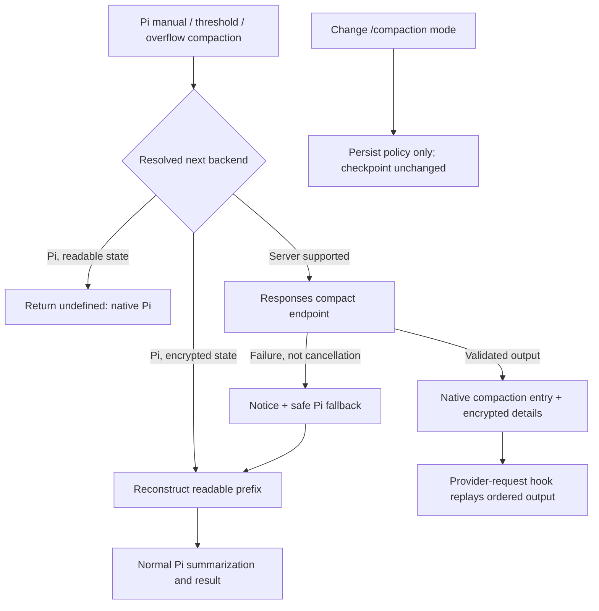

## Goal Description

Implement a project-local extension at `.pi/extensions/server-side-compaction/` that selects either standard Pi compaction or the OpenAI compaction endpoint, without changing Pi's installation or core.

Default policy is `auto`: supported OpenAI Responses and OpenAI Codex models use server compaction; other providers/APIs use ordinary Pi compaction. Users can configure defaults and switch the backend within an existing thread. The extension participates in Pi's existing manual `/compact`, automatic threshold compaction, and overflow recovery; it does not introduce a second compaction scheduler.

### Agreed requirements

- Support OpenAI Responses `/responses/compact` and the Codex/ChatGPT-login equivalent where supported.
- User/project configuration plus a branch-persisted `/compaction auto|pi|server` override.
- Unsupported models and endpoint errors fall back to Pi with a visible notice.
- Changing the backend changes the **next** compaction, not the current checkpoint.
- Server compaction follows Pi's existing trigger, preparation, cut point, and recent-tail retention. Replace only generation of the older-prefix readable summary with an endpoint-generated encrypted checkpoint bundle; do not adopt Codex's user-only/64k retention or full-conversation replacement.
- Normal server compaction does not also generate a Pi summary.
- Lazily reconstruct readable history when a subsequent Pi compaction needs it.
- When switching to an incompatible model while the active context depends on encrypted compaction, show a confirmation explaining that portable compaction is necessary. Accept converts and switches; cancel retains the previous model.
- Merely having an old encrypted item somewhere in abandoned/superseded history does not require conversion.

### Research findings

Inspected the installed Pi extension documentation, compaction documentation, provider/message/session/configuration references, installed declarations and runtime implementation, existing `codex-usage`, context/session handling, and installed-host compatibility tests.

Relevant installed APIs and implementation:

- `session_before_compact` provides `preparation`, `branchEntries`, `customInstructions`, `reason`, `willRetry`, and `signal`. Both manual and automatic paths support an extension `CompactionResult`; returning nothing delegates to the normal implementation.
- `CompactionResult` contains a text `summary`, `firstKeptEntryId`, `tokensBefore`, optional `usage` and arbitrary `details`. Pi stores details but projects the summary as readable text. It does not natively replay OpenAI compaction items from details.
- `before_provider_request` can replace the serialized payload. This provides a way to replay encrypted output without encoding ciphertext as a readable summary or abusing thinking signatures.
- `buildSessionProjection` and `buildContextEntries` preserve active-branch semantics and context edits. Session history remains in JSONL after compaction, enabling reconstruction.
- `compact`, `generateSummaryWithUsage`, `findCutPoint`, and session projection helpers are public exports. `prepareCompaction` is not exported from the package root; avoid importing private installed-host files.
- `ctx.compact()` starts asynchronously. Some already-compacted sessions have no new preparation and cannot immediately compact again through that API. A durable custom portable-checkpoint record plus context replacement supports immediate conversion without mutating the read-only session manager.
- `model_select` is notification-only and fires **after** Pi applies/persists a model change. It cannot veto a switch by returning a value. `pi.setModel()` can restore a previous model, with a recursion guard.
- OpenAI serialization helpers are exported through `@earendil-works/pi-ai/api/openai-responses-shared`. The installed OpenAI SDK exposes `responses.compact`, returning `object: response.compaction`, ordered `output` items including encrypted `type: compaction`, and usage.
- Codex provider defaults to `https://chatgpt.com/backend-api/codex/responses`; endpoint support and required compaction headers must be verified separately. SDK presence does not establish that every model/account supports compaction.
- Existing `codex-usage/usage.ts` demonstrates using `getApiKeyAndHeaders()` for refresh-safe authentication, validating account IDs, blocking redirects, and not exposing response bodies/secrets.
- The repository uses Node's test runner and installed-host extension loading; no root package.json/build script exists.

## User Review Required

> [!IMPORTANT]
> The chosen design is **Pi retention with an encrypted summary**, not Codex retention. Generation context becomes current system/tool state + endpoint checkpoint bundle for the older prefix + the exact recent messages Pi retained. The endpoint bundle can include preserved older user messages as well as the encrypted compaction item; both must be kept because the endpoint may not encode those user messages in the encrypted item.

> [!IMPORTANT]
> Backend selection and checkpoint compatibility are separate. `/compaction pi` leaves an existing encrypted checkpoint intact for compatible OpenAI generation. Only the next compaction uses Pi. Switching to a model/account/endpoint that cannot consume that checkpoint needs conversion first.

> [!IMPORTANT]
> Conversion reconstructs readable history and makes a normal summarization call. Very long histories may require bounded multi-stage summarization. This is additional latency/cost only when conversion is needed, not on each server compaction.

> [!WARNING]
> Extension-only encrypted checkpoints depend on this extension being loaded. Disabling/uninstalling it before conversion will not magically make ciphertext readable by stock Pi. Provide `/compaction portable` to prepare a readable checkpoint before disabling the extension, and a prominent README warning. This limitation is intrinsic to storing the encrypted payload in extension details.

> [!WARNING]
> Pi has no pre-model-switch veto hook. The guarded restoration flow may leave attempted/restored model-change records in history. Validate native `/model`, cycling, `pi.setModel`, and restore behavior against the installed host before treating cancellation as reliable. If restoring inside the event is unsafe, stop and revise the plan rather than modifying Pi core or silently ignoring cancellation.

Current unrelated working-tree changes must be preserved. In particular, do not overwrite the existing walkthrough; update it with a related section only after implementation and validation.

## Open Questions

No remaining user-facing requirement questions. Implementation investigations with explicit gates:

1. Verify Codex compaction route and response schema with authoritative provider references and an opt-in real-account smoke test. Candidate route: `/backend-api/codex/responses/compact`. Treat availability as conditional and fall back if unsupported.
2. Verify serialized checkpoint-marker identification, load ordering, and request hooks for generation versus nested summarization. Never rewrite unrelated nested requests.
3. Verify the model restoration/confirmation path, including scoped-model cycling and restored sessions. No incompatible request may proceed during conversion.
4. Cross-model ciphertext portability is not assumed: use a conservative compatibility key covering provider/API, endpoint, account identity, and initially model ID. Relax model-ID matching only with documented/tested support.
5. If project/host configuration cannot supply the effective network/proxy environment to the endpoint client through public APIs, explicitly document the supported environment-based behavior; do not claim parity with all Pi-managed transport settings.

## Proposed Changes

### 1. Configuration and policy

#### [NEW] `.pi/extensions/server-side-compaction/config.ts`

Read optional extension-owned files:

- `<effective Pi agent directory>/server-side-compaction.json` (respect Pi's agent-directory override).
- `<ctx.cwd>/.pi/server-side-compaction.json` when project trust permits.

Neither file is created automatically. Ship documented examples, not a project configuration that changes other users' defaults. Strict validation rejects unknown fields, malformed enums, unsafe numeric limits, and invalid override keys. Missing files mean built-in defaults; invalid configuration disables server selection with an actionable warning rather than crashing unrelated extension startup.

Illustrative schema:

```ts
type Mode = "auto" | "pi" | "server";
interface Config {
  mode?: Mode;
  providers?: Record<string, Mode>;
  models?: Record<string, Mode>; // exact provider/modelId
  timeoutMs?: number;            // default 120000
  maxResponseBytes?: number;     // default 32 MiB
}
```

Precedence: active branch command override > merged exact-model override > merged provider override > configured mode > `auto`. Project values override user values; override maps merge by key. `auto` resolves server only for supported Responses adapters; OpenAI Chat Completions, Azure, OpenRouter, and arbitrary compatible endpoints do not automatically qualify based on model-name prefixes.

Do not allow arbitrary credential-bearing endpoint URLs in the initial version. Use the selected model's configured base URL only through an explicitly supported adapter; unknown hosts/APIs default to Pi. No secrets in configuration or persisted state.

#### [NEW] `.pi/extensions/server-side-compaction/state.ts`

Persist mode changes using `pi.appendEntry("server-side-compaction.mode.v1", { mode })`. Reconstruct from the active branch on startup, switch/fork/tree navigation, and reload. `/compaction reset` appends a reset record rather than resurrecting an older override.

Separate selected policy from current checkpoint backend and compatibility. Persist successful encrypted output within `CompactionEntry.details`, not a loosely paired custom entry:

```ts
interface ServerCheckpoint {
  kind: "server-side-compaction";
  version: 1;
  marker: string;
  compatibility: {
    provider: string; api: string; model: string;
    endpoint: string; accountFingerprint?: string;
  };
  output: unknown[]; // validated Responses input-compatible output, original order
  source: {
    baseReadableCompactionId?: string;
    summarizedThroughEntryId: string;
    firstKeptEntryId: string;
  };
  readFiles: string[];
  modifiedFiles: string[];
}
```

Account fingerprint must not contain the access token. Validate checkpoint versions and source anchors on reconstruction; unknown/corrupt checkpoints must not silently become normal summaries.

---

### 2. OpenAI endpoint and serialization adapter

#### [NEW] `.pi/extensions/server-side-compaction/openai.ts`

- Identify supported provider/API pairs and derive API-key/Codex compaction URLs without duplicate `/responses` suffixes.
- Resolve fresh credentials and headers with `ctx.modelRegistry.getApiKeyAndHeaders(model)`. Preserve appropriate model/auth headers. For Codex, apply account/originator headers according to the verified provider contract; never copy or edit auth.json.
- Serialize messages through the installed public Responses serializer rather than writing a lossy text-only converter. Respect images, reasoning, tool-call IDs/results, system checkpoints, provider transforms, and grammar/custom-tool behavior supported by the adapter.
- Send only compaction-contract fields, principally `model`, `input`, and `instructions`. Do not blindly send generation-only `tools`, streaming, `store`, or output-token options.
- Combine event cancellation and timeout. Cancellation cancels the operation; it is not an endpoint failure that should start another model call.
- Reject redirects, bound body reads, check status, parse and validate JSON/output/usage, and retain the **entire ordered output**, not just encrypted content. Never decode or summarize ciphertext as text.
- Safe error reporting includes status/classification, never raw bodies, tokens, or transcripts. Avoid unbounded retries; initially one attempt followed by Pi fallback.
- Unsupported endpoint/model responses can be cached for the current runtime/model/account to avoid repeated futile automatic requests; clear on reload/credential/model changes.
- Normalize available usage using model pricing without inventing unavailable cost/accounting fields.

Illustrative request (actual Codex fields subject to verification):

```ts
const auth = await ctx.modelRegistry.getApiKeyAndHeaders(model);
const response = await fetch(adapter.compactUrl(model), {
  method: "POST", redirect: "error", signal,
  headers: adapter.headers(model, auth),
  body: JSON.stringify({ model: model.id, input, instructions }),
});
```

---

### 3. Compaction checkpoints, projection, and lazy reconstruction

#### [NEW] `.pi/extensions/server-side-compaction/checkpoint.ts`

Use Pi's existing preparation/cut point to compact the discarded prefix while retaining recent messages **unchanged**. Honor the effective `keepRecentTokens`, reserve settings, active branch/context edits, manual instructions, and automatic/overflow lifecycle. Do not send the retained tail to the endpoint, let the endpoint choose Pi's kept boundary, apply Codex's 64k user-message retention, or replace the entire conversation.

Build endpoint input from prior summary/checkpoint context, `messagesToSummarize`, and `turnPrefixMessages` where applicable, in chronological order with no overlap. A previous readable summary is represented as readable context; a previous encrypted bundle is replayed as structured endpoint input. For a split span, compact the discarded span prefix together with preceding history in one checkpoint request rather than generating Pi's two separate text summaries. This preserves the same external retention boundary without copying a text-summary-specific implementation detail.

Validate that the compacted prefix and retained tail form a legal tool-call/result sequence. Never send a dangling tool result or duplicate the retained prefix.

The endpoint-generated replacement **summary bundle** consists of its full validated ordered output, including any preserved user messages and the encrypted compaction item. These returned user messages replace the corresponding discarded-prefix context; they do not duplicate Pi's kept tail. Do not take only the encrypted item unless the chosen endpoint contract explicitly guarantees all required prefix context is encoded in it.

Expected subsequent request:

```text
Pi's current system instructions and tool state
+ endpoint output for the discarded prefix
  (preserved older user messages + encrypted compaction item)
+ original messages from Pi's firstKeptEntryId onward
+ messages appended after compaction
```

Only the summary representation changes. The same tail entry IDs and contents must survive Pi and server compaction for an identical preparation.

Store a recognizable human-facing summary marker such as `Server-side OpenAI checkpoint [unique checkpoint ID]`, with the actual encrypted output in details. The marker is a transport anchor, **not** a semantic summary.

Through a narrowly scoped `before_provider_request` transformation, replace only the serialized checkpoint-summary marker with the checkpoint output. Preserve current system instructions, current tools, retained messages, and all post-checkpoint entries. Rewriting is checkpoint-compatible and request-scoped, not conditioned solely on the currently selected backend.

Do not replace the entire generation input with an old captured payload. Fresh tools/system changes and extension transformations must continue to apply. Verify exact marker mapping and fail closed if it cannot be located unambiguously. Nested summary requests are excluded by an explicit operation guard and must contain readable reconstructed history instead.

Reconstruction algorithm:

1. Locate the active encrypted checkpoint in the active, compaction-aware branch projection.
2. Follow its source anchors to the nearest readable Pi/portable checkpoint (or session start).
3. Reconstruct only context-visible source history through the encrypted checkpoint's summarized boundary; use projection/context-edit semantics, not every raw history entry.
4. Exclude abandoned branches, UI-only entries, `!!` excluded shell output, deleted context, failed overflow attempts Pi omitted, and obsolete summaries.
5. Add retained/post-checkpoint messages exactly once when preparing subsequent compaction; leave them outside a prefix-only portability conversion.
6. Detect missing source entries/anchors and report a recoverable error; never persist an empty placeholder summary.

When the selected backend is Pi and the active checkpoint is encrypted, invoke the public normal Pi `compact` helper with a reconstructed preparation and authenticated provider-neutral stream function, returning its real `CompactionResult`. With no encrypted dependency, return `undefined` so native Pi owns compaction unchanged. Preserve custom instructions, reserve/keep settings, file metadata, split-turn behavior, usage, and abort handling.

If the readable history exceeds the summarizer's input budget, summarize ordered chunks with reserved output space and carried-forward readable summaries. Preserve intact tool-call/result groups and collect total usage. Do not require decrypting old checkpoints.

For immediate portability conversion, persist a `server-side-compaction.portable.v1` custom entry keyed to the encrypted checkpoint ID, containing a real readable summary, source anchors, and conversion usage/accounting metadata. Use `context_with_system` to replace that active checkpoint summary with the portable text while preserving the leading system message. Suppress encrypted injection for that converted checkpoint. Later compaction consumes this portable summary normally. This works even when stock `/compact` would reject an already-compacted session. Do not mutate session manager internals to force a new native entry.

Verify usage persistence with supported usage entry APIs or boundary entries; do not double-count conversion usage or misrepresent it as free.



---

### 4. Commands, lifecycle, and model-switch confirmation

#### [NEW] `.pi/extensions/server-side-compaction/index.ts`

Register:

- `/compaction` or `/compaction status`: selected mode, effective next backend/reason, active checkpoint type, configured fallback/availability.
- `/compaction auto|pi|server`: branch-local next-compaction policy only.
- `/compaction reset`: return to configured policy.
- `/compaction portable`: explicitly convert an active encrypted checkpoint, including before disabling the extension.

No new model-callable tools initially. If one is subsequently requested, its arguments must reject extra fields per AGENTS.md.

Use existing `/compact [instructions]` for executing compaction. Do not shadow it. Register mode status under an extension-owned UI key, clear on shutdown, and guard TUI-only display. Errors/fallbacks remain observable in supported non-TUI integrations without corrupting stdout JSON protocols.

Illustrative interception:

```ts
pi.on("session_before_compact", async (event, ctx) => {
  const backend = resolvePolicy(ctx.model, config, branchMode);
  if (backend === "pi" && !activeEncryptedDependency(ctx)) return;
  try {
    return { compaction: await runSelectedBackend(event, ctx, backend) };
  } catch (error) {
    if (event.signal.aborted) return { cancel: true };
    reportSafeFallback(error, ctx);
    return activeEncryptedDependency(ctx)
      ? { compaction: await compactReconstructedHistory(event, ctx) }
      : undefined;
  }
});
```

Fallback summarization errors are surfaced, not caught as another endpoint error or recursively retried.

#### [NEW] `.pi/extensions/server-side-compaction/switch.ts`

Implement a serialized transition state machine:

1. On `model_select`, compare requested target to the active encrypted dependency. If no dependency or compatible, do nothing.
2. Guard recursion and restore the previous compatible model while confirmation/conversion is pending. Because the hook is post-change, verify this sequence against real host lifecycle.
3. Show `ctx.ui.confirm` with title `Compaction required to switch model` and explanation that OpenAI encrypted context cannot be read by the target, conversion uses a summarization call, and cancellation keeps the previous model.
4. Cancel: keep previous model and untouched checkpoint.
5. Accept: reconstruct and summarize using the previous compatible model/credentials (bounded chunks if necessary), persist the portable record only after complete success, then select the requested target.
6. Failure/cancellation: leave previous compatible model and original checkpoint active; show a safe error. Never allow target generation with a summary placeholder.
7. Track branch/session/generation identity through awaits; stale completion after session navigation must not mutate the new session. Cancel operations on shutdown/reload.

Busy transitions must not begin nested compaction or corrupt an active run. Reject/defer incompatible switching safely if no idle boundary is available. Add a request-time guard as defense in depth for programmatic/virtual-model paths that bypass normal selection events.

RPC with dialog support uses the same confirmation. Headless modes cannot accept implicitly: retain/restore the compatible model where possible and provide an actionable error instructing the user to run portability conversion. An incompatible restored session without a previous model must block generation until explicitly converted; no fake cancellation success.

Encrypted items buried under a later readable compaction or on an abandoned branch do not trigger confirmation. A portable record linked to the active encrypted checkpoint also removes the dependency.

---

### 5. Documentation and tests

#### [NEW] `.pi/extensions/server-side-compaction/README.md`

Document defaults, full configuration precedence/schema, commands, supported providers/APIs, endpoint availability, fallback, ciphertext persistence/privacy, lazy portability conversion and cost, headless behavior, disabling/uninstalling caveat, and how to recover by navigating original history if source reconstruction fails.

#### [NEW] `.pi/extensions/server-side-compaction/test.cjs`

Pure policy/config/state tests, strict parsing, checkpoint validation, URL/auth assembly, output ordering, reconstruction, safe errors, abort/timeout/body-size limits, and conversion chunking.

#### [NEW] `.pi/extensions/server-side-compaction/lifecycle.test.cjs`

Installed-host loader/SDK tests with deterministic fake providers and endpoint fetch mocks. Cover manual, threshold and overflow compaction; exact outgoing serialized inputs; ordinary Pi pass-through; server/Pi switching; repeated compaction; resume/fork/tree; confirmation accept/cancel/failure; scoped cycling; operation reentrancy; missing history; edits; tool groups; image and prompt/tool changes; nested requests; incompatible restores; headless refusal; and conversion after an already-compacted leaf.

#### [MODIFY] `tests/pi-compatibility.cjs`

Add a separate installed-host loading/API-contract test for this extension without changing existing unrelated assertions or assuming mocked contexts implement full provider/session functionality.

#### [MODIFY] `README.md`

Add the extension to the existing extension catalog and a short usage/default description; preserve all current uncommitted edits.

#### [MODIFY, after implementation only] `plans/walkthrough.md`

Append changes, commands, measured validation results, limitations, and a terminal screenshot/recording of the switch confirmation flow where tooling permits. Do not claim unperformed live tests passed.

### Implementation order / acceptance gates

1. Confirm public serialization APIs and prototype request replay, checkpoint boundaries, and model-change restoration using tests only after approval.
2. Implement strict configuration, branch state and endpoint adapters.
3. Implement encrypted checkpoint persistence/replay with exact input assertions.
4. Implement lazy readable reconstruction, bounded conversion and persistence.
5. Wire selection, native compaction interception, fallback, commands/status, confirmation and cleanup.
6. Complete regression tests and documentation; opt-in endpoint checks; record walkthrough.

No Pi core patch, monkey-patching global provider prototypes, new scheduler, or automatic configuration-file mutation is in scope. If a required acceptance gate cannot work through public extension APIs, report it and request a revised plan.

## Verification Plan

### Automated Tests

After implementation approval:

```bash
node --test .pi/extensions/server-side-compaction/test.cjs .pi/extensions/server-side-compaction/lifecycle.test.cjs
node --test tests/pi-compatibility.cjs
node --test .pi/extensions/*/test.cjs .pi/extensions/*/*.test.cjs tests/pi-compatibility.cjs tests/smoke.test.cjs
```

Use installed-host loading via the repository's existing jiti/loader pattern as the extension compilation/load check; do not invent a root npm build command. Tests use temporary sessions and fake credentials/providers, never billable real calls by default.

Critical assertions:

- Native Pi path is unchanged for non-OpenAI/readable sessions.
- Ordered endpoint output replaces the marker exactly once, with fresh system/tools/tail preserved.
- Given the same preparation, Pi and server modes keep exactly the same recent entry IDs and message contents; only the discarded-prefix summary representation differs.
- Endpoint input excludes the retained recent tail and includes the previous summary/checkpoint plus the complete discarded prefix, including split-span prefixes, exactly once.
- Endpoint-preserved older user messages are replayed with the encrypted item, not discarded or duplicated. Repeated compaction correctly feeds the previous bundle back into the next prefix request.
- Ordinary server compaction performs one endpoint request and no additional readable-summary model call; unsupported/failure fallback and explicit portability conversion are exceptions.
- Server-to-Pi backend selection causes no immediate conversion or checkpoint change.
- Next Pi compaction sees actual reconstructed text, never ciphertext/placeholder.
- Endpoint failure with an encrypted previous checkpoint still produces a semantic Pi summary.
- No checkpoint or portable record persists after failed/aborted summarization.
- Confirmation appears only for active incompatible encrypted dependencies; cancel restores the prior effective model, accept converts before target generation.
- Navigation/reload/fork do not leak policy/checkpoint state or stale async results.
- No raw body/credential leakage; redirects and oversized malformed payloads are rejected.
- Conversion usage is accounted for exactly once.

### Manual Verification

1. Load extension and inspect `/compaction` on an OpenAI Responses model, Codex model, and non-OpenAI model. Confirm `auto` selects the intended backend.
2. With an explicitly authorized small real session, run `/compact` and confirm the supported endpoint returns a checkpoint and the next generation recalls a pre-compaction fact. Perform API-key and Codex checks separately; unsupported Codex must clearly fall back.
3. Switch `/compaction pi`, confirm no immediate call/popup, add messages, then `/compact`; verify readable Pi checkpoint and preserved facts. Switch back to server and repeat.
4. With an active encrypted checkpoint, choose an incompatible model. Cancel and confirm the prior model still generates with the checkpoint. Repeat and accept; confirm conversion progress, target selection only after success, and retained context.
5. Repeat switching with no checkpoint, an old superseded encrypted checkpoint, and a fork without encrypted dependency; no unnecessary dialog.
6. Resume/reload, change branches, exercise configuration overrides, and test endpoint outage/cancellation.
7. Run `/compaction portable` before disabling the extension and verify the documented portability behavior. Explicitly verify the limitation when disabling it without conversion; do not conceal it.
8. Capture the confirmation flow and append actual validation results to the existing walkthrough after implementation.

### Codex source investigation: endpoint output versus client responsibilities

This investigation is pinned to the installed Codex binary's release, `rust-v0.162.1`, and compares the older endpoint-based implementation at `rust-v0.114.0` (with `rust-v0.104.0` for historical model-switch handling). Public GitHub source was inspected without installing packages, modifying project code, reading private Codex credentials, or making authenticated/billable calls. These are client implementation findings, not claims about undocumented server internals.

> [!IMPORTANT]
> Current Codex does **not** use the old unary `/responses/compact` implementation for its ordinary remote-compaction path. Version 0.162.1 uses a streamed Responses request with an appended `compaction_trigger`, extracts exactly one encrypted compaction output, and constructs the retained transcript locally. The public compaction endpoint and current Codex remote compaction are distinct contracts.

#### Endpoint-based Codex, version 0.114.0

Before calling the endpoint:

- Clone the active history, not the entire archival rollout.
- If estimated history plus base instructions exceeds the model context, trim trailing Codex-generated items until it fits or a non-generated item is reached.
- Preserve local ghost snapshots separately so `/undo` survives; these are not ordinary model input.
- Project history for supported input modalities.
- POST `model`, `input`, and canonical base `instructions` to `responses/compact`, with resolved provider/auth, conversation and subagent headers. It does not send ordinary tool declarations on this unary path.

After receiving `output`:

- Filter returned developer messages (potentially stale/duplicated instructions).
- Keep real user messages as recognized by Codex's parser, plus assistant messages and encrypted compaction items.
- Remove ordinary reasoning, tool calls/results, other tool artifacts, and unrecognized items from returned replacement history. Therefore even this implementation does not blindly install every returned item.
- Depending on compaction phase, rebuild canonical session context and place it before the last real user message; otherwise before the summary/compaction item when needed to keep that item last.
- Restore local undo snapshots, replace live history, persist replacement history, update the reference-context baseline, recompute token usage, and emit started/completed/error events.
- Version 0.104.0 additionally stripped a trailing model-switch update before the endpoint request and reattached it only after successful compaction. This is historical behavior, not a universal rule for all versions.

#### Current Codex, version 0.162.1

Before requesting remote compaction:

- Resolve provider capabilities: OpenAI and recognized Azure Responses providers default to remote V2; custom provider overrides can change support. Unsupported providers use local summarization. Experimental token-budget mode can instead start a new context window without server/model summarization.
- Run pre-compaction hooks and emit a context-compaction lifecycle item.
- Clone active history with metadata and collect user-goal IDs.
- If over the input context budget, rewrite a trailing run of tool outputs to a truncation notice (or empty tool-search result) while preserving call IDs and related metadata; stop at a non-rewritable boundary. Unlike the older implementation, this need not delete whole trailing calls/results.
- Project supported input modalities, attach bounded executed-tool-call metadata, and append `compaction_trigger`.
- Supply base instructions and visible tools. For Responses-lite histories containing `AdditionalTools`, use embedded history tools and empty leading base instructions/tool declarations instead of duplicating them.
- Use the normal Responses streaming client, selected effort/service tier and compaction request metadata. This may use WebSocket or HTTPS according to the normal transport machinery.

Response processing and local retention:

- Require a completed response and exactly one `Compaction` item. Other completed output items may occur but are not used to construct the replacement transcript.
- Retain selected messages from the **request input**, not returned user messages: actual user messages/hook prompts, eligible inter-agent messages, and optionally client-authored developer messages behind a feature flag.
- Exclude assistant messages, ordinary tool calls/results, prior encrypted compaction items, descendant-agent progress/channel posts, and inter-agent final-answer messages from the readable retained set. Exclude oversized inter-agent messages above 10,000 estimated tokens.
- Apply a 64,000-token retained-message budget, newest first, restoring chronological order afterward. Boundary messages can be truncated; source metadata is marked incomplete. This is not Pi's recent-tail retention rule.
- Preserve image/attached-notice grouping. With the image-budget feature enabled, charge images and keep image/tag groups atomic, favoring later content within an oversized image-containing boundary message. Feature-disabled behavior has different accounting; do not present it as unconditional.
- Append the one encrypted compaction item after the retained messages.
- Rebuild current canonical context/world-state updates, insert them at the expected user/summary boundary, prepend the new window prefix, and capture a comparison baseline.
- Advance auto-compaction window IDs; persist replacement history with response ID, model compatibility hash and other session metadata; recompute token usage; complete the lifecycle. Record compaction usage/budget and telemetry independently of the installed replacement transcript.

Retries and switching:

- Stream retry budget is capped at two retries **per transport**, also limited by provider configuration. Retry timing honors server advice. Exhausting WebSocket retries can switch to HTTPS and reset that transport retry counter, so this is not a blanket two-attempt cap.
- Previous-model compaction may be needed before sampling on a smaller-context model or when both models supply differing `comp_hash` values. This is stronger evidence than assuming all OpenAI model ciphertext is interchangeable.
- Certain failures of previous-model compaction can retry using the current compatible OpenAI/auth configuration. Aborts, interruptions, and exhausted session budget are excluded.
- Remote compaction failure is not automatically converted into local readable summarization in the inspected flow. Our requested Pi fallback is an extension policy, not Codex parity.
- Automatic compaction has pre-turn, mid-turn and post-turn paths, token limits/scopes, pending-input handling, and failure semantics; the endpoint does not schedule these.
- Resume/rollback reconstruction selects the latest surviving replacement-history checkpoint and its suffix, restoring settings/window/context metadata. The encrypted item alone is not a complete durable-session implementation.

#### Source references

All links are release-pinned:

- [0.114.0 endpoint compaction flow](https://github.com/openai/codex/blob/rust-v0.114.0/codex-rs/core/src/compact_remote.rs)
- [0.114.0 request body/headers](https://github.com/openai/codex/blob/rust-v0.114.0/codex-rs/core/src/client.rs#L273-L310)
- [0.114.0 endpoint transport/response parser](https://github.com/openai/codex/blob/rust-v0.114.0/codex-rs/codex-api/src/endpoint/compact.rs)
- [0.162.1 V2 output validation and retention](https://github.com/openai/codex/blob/rust-v0.162.1/codex-rs/core/src/compact_remote_v2.rs#L376-L777)
- [0.162.1 input preparation](https://github.com/openai/codex/blob/rust-v0.162.1/codex-rs/core/src/compact_remote_v2_attempt.rs)
- [0.162.1 pre-request history trimming](https://github.com/openai/codex/blob/rust-v0.162.1/codex-rs/core/src/compact_remote_history.rs)
- [0.162.1 image retention](https://github.com/openai/codex/blob/rust-v0.162.1/codex-rs/core/src/compact_remote_v2_images.rs)
- [0.162.1 canonical replacement-context assembly](https://github.com/openai/codex/blob/rust-v0.162.1/codex-rs/core/src/compact.rs#L80-L111)
- [0.162.1 provider capability selection](https://github.com/openai/codex/blob/rust-v0.162.1/codex-rs/model-provider/src/capabilities.rs)
- [0.162.1 retry/transport handling](https://github.com/openai/codex/blob/rust-v0.162.1/codex-rs/core/src/responses_retry.rs)
- [0.162.1 previous-model compaction](https://github.com/openai/codex/blob/rust-v0.162.1/codex-rs/core/src/session/turn.rs#L1335-L1425)
- [0.162.1 model fallback exclusions](https://github.com/openai/codex/blob/rust-v0.162.1/codex-rs/core/src/compact_model_fallback.rs)
- [0.162.1 resume/rollback reconstruction](https://github.com/openai/codex/blob/rust-v0.162.1/codex-rs/core/src/session/rollout_reconstruction.rs)

#### Consequences for this extension / resolved design

After reviewing Pi versus Codex, the user selected **Pi's current compaction behavior, with encrypted summary generation replacing readable summary generation**. The proposed prefix-only unary endpoint adapter is therefore intentional.

Send only the prefix that Pi would summarize, together with the previous summary/checkpoint. Install the validated ordered endpoint output in the summary slot and preserve Pi's existing recent tail unchanged. Endpoint-preserved older user messages are part of that summary bundle and must not be thrown away merely because the desired summary is encrypted.

Full-conversation endpoint replacement and current Codex's streamed `compaction_trigger`/client-side retention are **out of scope**. No Codex 64k retention cap, user-only retention rule, or new compaction scheduler will be introduced. Current-Codex findings above remain background research, not implementation requirements.

The backend-switch and lazy portable-conversion behavior agreed earlier remains unchanged. This design revision is not approval to implement.

### Planning status

Research and plan only. Implementation files have not been changed and tests/billable endpoint requests have not been run during planning. Await explicit user approval before proceeding.
