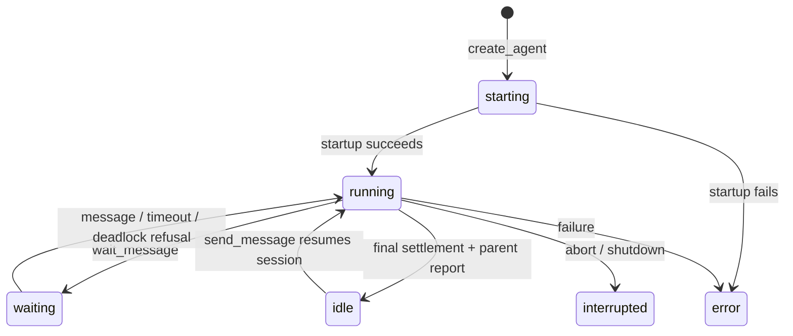

## Goal Description

Add a multi-agent workspace extension at `.pi/extensions/subagents/`. The main CLI conversation remains the sole interactive agent; named background agents have independent Pi sessions, configurable YAML templates, permitted tools/skills, parent relationships, asynchronous messaging, and a live read-only transcript viewer.

This is a plan only. No implementation changes or dependency installations have been made.

### Research findings

The installed host is `@earendil-works/pi-coding-agent` **1.1.0**, matching this repository's compatibility target.

Relevant inspected interfaces and examples:

- `docs/{extensions,sdk,configuration,settings,skills,tui,session-format,message-types,packages,models,sessions,security}.md` under the installed Pi package.
- `examples/extensions/subagent/agents.ts`: example discovery uses an extension-owned resolver, not a generic resource registration API. Its Markdown/frontmatter format is not the YAML format requested here.
- SDK examples `04-skills.ts`, `06-extensions.ts`, `13-session-runtime.ts`, and the preset extension example.
- Public declarations for resource loading, SDK sessions, prompt options, extension events, session storage, skills, and transcript rendering.
- Existing local plan-mode, goal-mode, context viewer, and compatibility test implementations.

Pi's resource types are fixed. `resources_discover` accepts skill, prompt, and theme paths; `ResourceLoader` additionally handles extensions and instruction/context files. **There is no generic custom-resource-type registration API.** `getAgentsFiles()` means AGENTS.md/context instructions, not agent templates.

Pi depends on `yaml@2.9.0` and publicly exports `parseFrontmatter()`. YAML itself is not one of the guaranteed host-provided extension imports. Use a declared local YAML dependency rather than relying on a transitive module or wrapping YAML files in synthetic Markdown frontmatter.

`createAgentSession`, `DefaultResourceLoader`, `SessionManager`, structured `before_agent_start` prompt options, `sendCustomMessage`, and `agent_settled` supply the necessary execution building blocks. `agent_end` is not final: retries, compaction, and queued work can follow it.

Public `AssistantMessageComponent`, `UserMessageComponent`, `ToolExecutionComponent`, and TUI `ScrollView` support a Pi-like viewer. `ctx.ui.custom()` can temporarily replace the interactive area without changing the active CLI session.

Existing plan-mode already limits much of its behavior to TUI mode. Goal-mode currently exposes tools and reminders to headless sessions, so worker exclusion and explicit role guards are necessary.

## User Review Required

> [!IMPORTANT]
> Confirmed decisions: extension-owned discovery with project overriding user; model inheritance resolved at creation and again on idle resume; workers load normal configured extensions except main-only extensions; skills include Pi's normal discovered skills by default; viewer is read-only and replaces the visible main frame, with scrolling/cycling rather than actual session replacement.

> [!WARNING]
> Agents share the working directory and OS permissions. Tool lists control model-facing and nested tool access, **not filesystem/process isolation**. Configured extensions execute code even if their tools are not selected. This extension will not add an offensive workflow or target-specific automation; it is general-purpose local task orchestration.

> [!IMPORTANT]
> Proposed defaults requiring approval: main instance is named `main`; template names are separate from instance names; default tools are `read`, `bash`, `edit`, `write`; communications tools are automatically provided; limits are 8 concurrently running workers and nesting depth 4, configurable. Normal main-session tools are preserved for the built-in main template so installing this extension does not disable existing workflows.

> [!WARNING]
> A project containing only `.pi/agents` does not trigger Pi's built-in trust discovery. Do not infer trust from the directory's existence. Honor `ctx.isProjectTrusted()` and skip project templates/config when false; explain `/trust` and the limitation in documentation. No pi-core patches are planned.

Existing dirty changes in `.pi/extensions/plan-mode/*` and `.pi/extensions/ui/*` must be preserved. Any role-guard edits will be minimal and based on the files as they exist at implementation time.

## Open Questions

No remaining blocking product questions. The following proposed policies are available for review before implementation:

- Restore workers as idle after process restart or `/reload`; do not automatically spend tokens resuming interrupted work. Retain pending durable messages for explicit restart/delivery.
- Main-session forks get a new workspace identity; tree navigation reconstructs membership from the selected branch. Do not let abandoned branches continue emitting unsolicited results into the selected branch.
- Templates selected through `/agent` configure the existing main instance; they do not reset its history or promote a worker to interactive role.
- Template tool extras must name registered tools exactly; no wildcard expansion initially. Unknown tools/templates are errors, not silently ignored by Pi's active-tool setter.
- Worker sessions live below the main session's configured session directory in `subagents/<workspace-id>/`, keeping ordinary main-session discovery less cluttered. Ephemeral main sessions get ephemeral workers.
- `skills.include_defaults: false` removes the automatically advertised default skill catalog. It does not erase previously read skill text from an existing conversation, or prevent explicit filesystem reads through allowed tools.

## Proposed Changes

### 1. Configuration, templates, and discovery

#### [NEW] `.pi/extensions/subagents/package.json`

Declare `yaml` as a runtime dependency, host packages as `peerDependencies: "*"`, and no bundled copies of Pi. Pin a tested YAML version consistent with the installed host; produce the local lockfile during approved dependency setup. New dependencies are not installed during planning.

#### [NEW] `.pi/extensions/subagents/types.ts`
#### [NEW] `.pi/extensions/subagents/config.ts`
#### [NEW] `.pi/extensions/subagents/templates.ts`
#### [NEW] `.pi/extensions/subagents/defaults/main.yaml`
#### [NEW] `.pi/extensions/subagents/defaults/subagent.yaml`

Use this explicit YAML schema (all nested objects reject unknown properties):

```yaml
name: reviewer
model:
  name: parent                  # parent | global | provider/model-id
  thinking: parent              # parent | global | off|minimal|low|medium|high|xhigh|max
tools:
  include_defaults: true
  extra: [grep, find, ls]
skills:
  include_defaults: true
  extra_paths: [./skills]        # relative to this YAML file
prompt: |
  Review the assigned change. Explain findings and supporting evidence.
subagents:
  allowed: [subagent]
  default: subagent
```

Rules:

- `name`: nonempty stable template name. Restrict names to a documented safe identifier format; do not use names as raw filesystem paths.
- Omitted/null/empty model and thinking values independently inherit `parent`; on main, parent falls back to global. Whitespace-only explicit identifiers are invalid except the documented empty inheritance form.
- Explicit model identifiers use `provider/model-id`, splitting only on the first slash because model IDs can contain slashes. Resolve through the model registry; reject unknown/unavailable chat models with actionable errors.
- `global` means the user's model/thinking choice in the main session, not the persisted startup default. Maintain a separate global selection while `/agent` may apply an explicit main template model; suppress template-originated selection updates from overwriting global state.
- Resolve model/thinking at worker creation and whenever an idle instance is restarted. Do not change running agents mid-turn. Preserve Pi's supported-thinking-level clamping and expose the effective level in diagnostics.
- Tools default to `{include_defaults: true, extra: []}`. Skill configuration defaults to `{include_defaults: true, extra_paths: []}`. Prompt defaults to empty additional text.
- `subagents` defaults to `{allowed: []}`. `default`, when present, must be in `allowed`; having an allowlist does not implicitly select its first entry. Validate references after registry resolution.
- With no allowed subagents, no reachable `create_agent` tool. With allowed subagents but no default, callers must provide a template.
- Duplicate keys, multiple YAML documents, unsupported tags, invalid collections, oversized documents, and pathological alias expansion are rejected. Do not use unsafe custom YAML constructors.

Built-in templates have identical model/tool/skill/prompt settings. Only their `subagents` section differs:

```yaml
# main.yaml
name: main
subagents:
  allowed: [subagent]
  default: subagent
```

```yaml
# subagent.yaml
name: subagent
subagents:
  allowed: []
```

Unspecified fields normalize to the defaults above.

Discovery precedence, lowest to highest:

1. Bundled templates.
2. `<getAgentDir()>/agents/`.
3. User extra paths, in declaration order.
4. Trusted `<cwd>/.pi/agents/`.
5. Trusted project extra paths, in declaration order.

Later tiers override earlier templates by `name`; duplicate names within a tier are errors. File traversal is deterministic. Discover `.yaml` and `.yml` files, retaining provenance and override diagnostics. Do not search arbitrary ancestor projects: match Pi's current-directory `.pi` convention, rather than claiming identical behavior to its different skill/context discovery rules.

Extension-owned settings files:

```json
// <agent-dir>/subagents.json or trusted <cwd>/.pi/subagents.json
{
  "agent_paths": ["./more-agents"],
  "max_running": 8,
  "max_depth": 4,
  "worker_exclude_extensions": []
}
```

Resolve config-relative paths against the owning configuration directory and `~` against the home directory. Merge path lists user then project; project overrides scalar options. Read only trusted project config. These are **not** new Pi `settings.json` keys or package-manifest resource types. Initial package-provided agent directories require explicit paths.

Malformed overrides must not silently reveal an older template with the same name. Quarantine ambiguous/invalid entries, report the source path, and retain unrelated valid templates. Reload registry atomically; running instances retain their normalized template snapshot until idle.

---

### 2. Workspace identity and persistence

#### [NEW] `.pi/extensions/subagents/workspace.ts`
#### [NEW] `.pi/extensions/subagents/persistence.ts`
#### [NEW] `.pi/extensions/shared/agent-role.ts`

One coordinator per active root session owns workspace membership, instance names, routing, inboxes, state transitions, resource limits, and worker sessions. Attach worker tool closures to this coordinator; do not recursively instantiate the root extension in each worker.

```typescript
type AgentStatus = "starting" | "running" | "waiting" | "idle" | "error" | "interrupted";
type AgentRole = "interactive" | "worker";
interface AgentIdentity {
  version: 1;
  workspaceId: string;
  instanceId: string;
  name: string;
  template: string;
  role: AgentRole;
  parentName: string | null;
  rootSessionFile?: string;
}
```

Instance names are unique throughout a workspace, immutable, case-sensitive, and never reusable for a different instance. `main` is reserved for the root. Sender identity comes from the calling tool's closure, never a model-supplied sender argument.

Persist custom non-context entries through Pi's session manager APIs:

- `subagents.identity.v1` in every session.
- `subagents.member.v1` in root and parent sessions for child membership, path, and normalized template snapshot.
- `subagents.state.v1` for lifecycle checkpoints and run IDs.
- `subagents.delivery.v1` for durable message enqueue/delivery/acknowledgment metadata.
- `subagents.template.v1` for `/agent` selection and current global selection.

Context messages use `subagents.message.v1`, with sender/recipient/message ID in `details` and visible sender attribution in text. Preserve identities and parent links through compaction using non-context entries, not only system prompt prose.

Create one Pi JSONL session per worker using `SessionManager.create()` and reopen using `SessionManager.open()`. Use the main configured session directory, UUID-based workspace layout, and normal Pi headers; do not hand-edit JSONL. Confirm Pi's lazy persistence behavior and ensure identity/membership is durable before reporting successful startup.

Reconstruct branch-sensitive root membership from `getBranch()`. Worker session paths are validated against the known workspace storage root; missing/corrupt files become visible unavailable/error entries rather than fresh silent replacements.

Persist message IDs and delivery state for deduplication. Crash recovery is **at-least-once**, not a cross-file transaction guarantee: document the small crash window between context persistence and acknowledgment and reconcile against context message IDs. Completion IDs include worker run ID to prevent normal reload/retry duplicates.

Fork/new/root-switch policies detach, abort, and dispose previous active workers; do not share mutable execution across unrelated roots. A fork must mint a new workspace and avoid reusing original workers as writable sessions. On `/reload` or shutdown, cancel timers/waits, abort active worker runs, unsubscribe listeners, persist interruption state, and dispose sessions idempotently. Do not exit the host process from a worker.

Role detection defaults to interactive for ordinary unmarked sessions, maintaining current extension behavior. Explicit worker identity is authoritative even if its file is opened in the CLI.

---

### 3. Worker SDK runtime and loadouts

#### [NEW] `.pi/extensions/subagents/runtime.ts`
#### [NEW] `.pi/extensions/subagents/loadout.ts`

Create independent SDK sessions in-process, all with the workspace's cwd and inherited project-trust decision. Use a worker `SettingsManager`, `DefaultResourceLoader`, and `createAgentSession()`; bind extensions explicitly.

Load configured user/project extensions normally, except this root subagents extension and known main-only plan-mode, goal-mode, ask-question, context-browser, and UI extensions. Preserve provider and useful tool extensions, including the repository's enhanced bash extension. Filtering must happen **before extension factories execute**, not merely after registrations are returned. Use settings/resource-path filtering and explicit loader inputs; verify package and configured-path behavior against the host rather than using private CLI runtime fields.

Inline worker extension factories register identity, communications, prompt augmentation, and a tool-call guard. Mark identity before `session_start` handlers see the session. Normal project resources must not gain trust merely because the SDK loader is used headlessly.

Load skills with Pi's public discovery helpers and resource loader:

- `include_defaults: true`: use normal configured/default Pi discovery for that worker, plus template extra paths.
- `false`: only template extra paths, no default/configured catalog.
- Retain Pi's skill collision diagnostics and `disable-model-invocation` semantics.
- Do not copy parent messages or skill bodies; the task and explicitly routed messages are the worker's context inputs.

System prompt additions use structured prompt options, preserving Pi's prompt/context/tool rules:

```typescript
event.systemPromptOptions.sections.agent_identity =
  `You are ${identity.name}. Role: worker. Parent: ${identity.parentName}. ` +
  `Report through workspace communications. Final output is sent to your parent.`;
event.systemPromptOptions.sections.agent_template = template.prompt;
```

Also explain permitted child template names/default and current communications semantics in an orchestration section.

Effective worker tools:

```text
(include_defaults ? read,bash,edit,write : empty)
+ explicitly named extra tools
+ send_message,wait_message,list_agents
+ create_agent only when allowed child templates are nonempty
```

Main built-in/default template preserves existing active main tools and adds orchestration tools. Custom main templates can narrow the general-purpose selection, but retain tools owned by enabled main-only workflows so `/plan` and `/goal` remain usable. Document and test this deliberate main/worker distinction.

Do not equate `setActiveTools()` with a complete allowlist: `codemode`/`deferred` tools can remain callable while inactive. Enforce disallowed nested calls via a `tool_call` guard and withdraw forbidden tool registrations using hidden exposure where supported. Keep the selection consistent after late MCP registrations or dynamic tool changes. Unknown names fail validation rather than disappearing silently. `create_agent` must be hidden/unreachable on leaf templates, including codemode/tool-search paths.

Task startup is fire-and-observe: await configuration/auth/loadout preflight and durable membership, schedule the worker task, then promptly return “Agent <name> started.” Never await the entire worker run from `create_agent`. Catch detached promise failures and route an attributed failure notice to the parent.

---

### 4. Messaging tools and state machine

#### [NEW] `.pi/extensions/subagents/tools.ts`
#### [NEW] `.pi/extensions/subagents/messages.ts`

All tool parameter schemas use `additionalProperties: false`. Return required `content` and `details`; use structured output schemas for machine-readable listing/start/message results. Invalid arguments, unknown agents, unauthorized templates, capacity failures, and deadlock refusal throw real tool errors.

```typescript
create_agent({
  name: string,
  task: string,
  agent_template?: string | null,
})
send_message({agent_name: string, message: string})
wait_message({timeout?: number}) // seconds, default 120, range >0 through 600
list_agents({all?: boolean})    // default false
```

Use the intended spellings `message`, `timeout`, and `create_agent`, not typo aliases.

`create_agent` resolves null/omitted template only through the caller's configured default. Explicit templates must be in its allowlist. Validate name/task before allocating anything, reserve the name atomically, and roll back failed startup without leaving a phantom runnable worker.

`send_message` can address any member of the same workspace, including parent/siblings. It accepts nonempty bounded text; no arbitrary external session path. Self-messaging is rejected to avoid trivial loops. Return acknowledgment after durable enqueue and dispatch scheduling, not after the recipient completes.

Delivery:

1. Persist an attributed envelope with stable ID.
2. If recipient is waiting, resolve its waiter and queue the envelope as steering context.
3. If recipient is running, enqueue a custom steering message. Pi delivers it at the next supported turn/tool boundary, not instantly in the middle of a provider stream.
4. If recipient is idle, re-resolve inherited model/thinking and schedule `sendCustomMessage(..., {deliverAs: "steer", triggerTurn: true})` on the existing session.
5. Serialize scheduling per recipient to avoid double-starting an idle instance. Do not await the recipient's full run inside the workspace routing lock.

Never hold a workspace/recipient mutex while executing a model run or waiting for a message. Reserve the mutation lock for short state changes.

`wait_message` uses a coordinator inbox and waiter, not polling the SDK steering queue. A steering queue only drains after tools finish, so queueing without waking the waiter would deadlock. Waking returns message IDs/senders in tool details and a short acknowledgment; full message content appears once as attributed context after the tool result. Maintain distinct unread-for-wait bookkeeping so messages arriving immediately before wait are not missed. Consume a batch of pending unread envelopes and avoid duplicate context insertion.

Wait is cancellable with the tool signal; clean up timers/listeners on receipt, timeout, abort, root switch, or reload. Timeout is a normal result saying no message arrived; cancellation follows Pi's cancellation behavior.

Deadlock check atomically marks the caller waiting and evaluates workspace state. If no other agent can make progress (all waiting/idle/error/interrupted and no pending delivery/startup), refuse the newest wait:

```text
Everyone else is waiting or idle. Message an agent or keep working.
```

Include main state; an idle main user is not counted as guaranteed future progress. Re-evaluate outstanding waits whenever the last runnable instance stops, so older waits do not remain blocked until timeout. Release one deterministically with the same diagnostic. Starting/queued agents count as potential progress, but unread messages always take priority.

`wait_message` must not monopolize Pi's sequential tool lane and prevent a sibling `send_message` from executing. Use parallel execution for the wait tool with one waiter per instance; use short coordinator locks for create/send operations. Test mixed parallel tool batches explicitly.

`list_agents()` returns direct children, including idle children. `all: true` returns every workspace member including main, parent links, template, role, status, effective model/thinking, and unavailable-file diagnostics. Stable creation order; no UI-only hiding affects tool results.



Final reporting uses `agent_settled` and tracked run outcome/last finalized assistant text. A successful final text becomes an attributed message to the parent once per run; interrupted/error runs emit a distinct status notice instead of pretending success. An empty final answer sends a clear completion-without-text notice. Main has no parent and never auto-reports. Worker objects remain addressable after settlement; idle sessions can be kept or lazily reopened without discarding history.

---

### 5. Root extension and main-only integrations

#### [NEW] `.pi/extensions/subagents/index.ts`
#### [MODIFY] `.pi/extensions/plan-mode/index.ts`
#### [MODIFY] `.pi/extensions/goal-mode/index.ts`
#### [MODIFY] related main-only extensions only if needed for explicit role guards

Initialize registry/coordinator at session startup, not in extension factory side effects. Root role is `interactive`; worker role never changes based on UI selection or template name.

Add `/agent [template]` with template completion and an interactive picker when omitted. Apply changes when main is idle, or explicitly defer/reject while busy; no mid-stream tool/model mutation. It changes the existing root template and persists the choice, retaining main instance name, role, conversation, and children. Existing children remain valid after allowlist changes; the new allowlist governs future creation.

Use prompt options to adjust the main skill catalog and add template/identity instructions. Add extra skill paths through supported resource discovery where applicable. Pi's main resource loader cannot be arbitrarily replaced through ExtensionAPI: catalog filtering through `before_agent_start` affects model advertisement, not deletion of `/skill:` commands or old context. Clearly document this limitation instead of claiming a security restriction on skills.

Guard plan/goal session handlers and tools against explicit worker identity, preserving ordinary unmarked headless behavior. Illustrative change:

```diff
+import { isWorkerSession } from "../shared/agent-role.js";
 pi.on("before_agent_start", (event, ctx) => {
+  if (isWorkerSession(ctx.sessionManager)) return;
   // Existing interactive workflow instructions remain unchanged.
 });
```

Registration-time exclusion is the primary worker defense; execution/event guards are defense in depth. Do not rely on extension load order or a process-wide environment variable to identify worker sessions.

---

### 6. Read-only live agent viewer

#### [NEW] `.pi/extensions/subagents/view.ts`
#### [NEW] `.pi/extensions/subagents/transcript.ts`

`/agents` opens a custom non-overlay screen occupying the main interactive area. It does not invoke `switchSession()`, steal worker runtime ownership, promote an agent, or expose a message editor.

Layout:

- Compact active-agent rail/header showing names, parent relationships, status, and selected model.
- Selected agent's full-width Pi-like transcript, updated live from SDK events, including streaming assistant text, tool calls, partial tool outputs, and results.
- Idle agents hidden from the active rail by default; separate expandable “Idle (N)” section includes retained transcripts and failed/interrupted agents with status labels.
- Main is always accessible. While viewing another agent, main can continue executing and receiving messages.
- `Tab`/`Shift+Tab` or left/right cycle active agents; up/down, PageUp/PageDown, Home/End scroll the selected transcript; `i` toggles the idle section; Escape returns to the actual main conversation.
- Preserve per-agent scroll position. Follow streaming output only while at the bottom; scrolling upward disables follow until End/bottom is selected.
- If the selected agent becomes idle, keep its displayed transcript until the user switches rather than abruptly navigating away.

Reuse publicly exported Pi transcript components and worker tool renderers. Maintain a lightweight event-backed projection; do not copy raw ANSI output or instantiate a second TUI. Use public Markdown/ScrollView primitives and safe fallback renderers for unsupported custom entries. Honor theme invalidation, hide-thinking preference, width, image settings, and tool expansion where available. Match the main rendering closely without promising that all local UI extension patches automatically apply to exported components.

The root ExtensionAPI has no general subscription to the CLI's entire transcript runtime. For the main viewer entry, use session branch snapshots plus registered message/tool events; worker entries use `session.subscribe()`. Include final persisted history and in-flight deltas without duplicating finalized messages.

Open through `/agents` while main is waiting/running without awaiting main idle; commands are supported during streaming. Verify actual `ctx.ui.custom()` focus/streaming behavior on the installed host. If regular-mode rendering differs, keep keyboard navigation functional and document it. RPC/JSON/print modes retain tool behavior and textual `/agents` diagnostics; no custom terminal UI is invoked outside TUI mode.

Dispose viewer subscriptions on close and coalesce render updates; no continuous timer when closed.

---

### 7. Documentation and tests

#### [NEW] `.pi/extensions/subagents/README.md`
#### [NEW] `.pi/extensions/subagents/test.cjs`
#### [NEW] `.pi/extensions/subagents/runtime.test.cjs`
#### [NEW] `.pi/extensions/subagents/ui.test.cjs`
#### [MODIFY] `.pi/extensions/plan-mode/test.cjs`
#### [MODIFY] `.pi/extensions/goal-mode/test.cjs`
#### [MODIFY] `tests/pi-compatibility.cjs`
#### [MODIFY] `README.md`
#### [NEW or MODIFY after implementation] `plans/walkthrough.md`

Follow existing Node test/esbuild patterns, but supplement mocks with actual installed-Pi SDK tests. Test registry, coordinator, routing, and lifecycle as separable units. Use temporary directories and a deterministic fake provider for SDK integration; no paid API calls in automated tests.

Implementation sequence:

1. Dependency/schema/discovery and tests.
2. Role identity and workspace/session persistence.
3. Worker resource loading and strict loadout enforcement.
4. Messaging, wait/deadlock behavior, completion routing, cancellation.
5. Root `/agent` and main-only integration guards.
6. Live transcript projection/viewer.
7. Compatibility/regression checks, manual TUI validation, docs and walkthrough.

Each stage must pass its focused tests before adding UI complexity.

## Verification Plan

### Automated Tests

After approval only, install the declared local dependency and run:

```sh
npm --prefix .pi/extensions/subagents install --ignore-scripts
node --test .pi/extensions/subagents/test.cjs
node --test .pi/extensions/subagents/runtime.test.cjs
node --test .pi/extensions/subagents/ui.test.cjs
node --test .pi/extensions/*/test.cjs .pi/extensions/*/ui.test.cjs tests/pi-compatibility.cjs
```

The final command deliberately includes UI tests omitted by the current README's narrower glob. Extend the installed-host compatibility test to include the new extension and verify real argument validation and public API compatibility; do not claim a compiler build from stub-based bundling alone.

Automated coverage:

- YAML defaults/types/unknown keys/duplicate keys/aliases; model IDs containing slashes; malformed override handling.
- Built-in/user/project/extra precedence, custom agent directory, trust rejection, deterministic reload, provenance, missing references/default validation.
- Parent/global independent inheritance, explicit main template versus user global selection, idle-resume resolution, thinking clamping.
- Leaf creation-tool absence in direct/codemode/nested access; strict allowlist after late registrations; exact unknown-tool failures.
- Default and extra skill catalogs; default-disabled filtering; no copying of parent transcript.
- Session identity present before extension startup; same cwd/trust; main-only factories excluded; ordinary headless goal tests unchanged.
- Startup acknowledgment occurs before run completion; failed allocation rollback; duplicate names, bounds, concurrency/depth limits.
- Running/waiting/idle delivery, rapid concurrent sends, unread messages preceding wait, sender spoof prevention, message-ID reconciliation.
- Wait timeout, cancellation, all-waiting refusal, idle peers, last runner settlement, in-flight startup, pending inbox, mixed parallel wait/send calls.
- Retry and queued-turn settlement yields one parent report; empty final output, errors, aborted runs, resume cycles.
- Real SDK session JSONL persistence/reopen, compaction, restart recovery, root branch/fork/new-session isolation, missing child files, ephemeral sessions.
- Shutdown/reload cancels active work, releases waiters/listeners, and prevents old callbacks routing into the new workspace.
- Transcript projection merges deltas/final messages without duplicates; tool partial/final rendering, idle grouping, scroll-follow, agent cycling, theme/resize/narrow-width/wide-character behavior.

### Manual Verification

Run Pi in a disposable trusted directory with local test templates and available credentials:

1. `/agent` lists templates and provenance; switching leaves main history/name intact. `/plan` and `/goal` remain functional on main.
2. Start two named workers. Confirm separate JSONL files, identity/parent metadata, expected skills/tools, and initial parent identity prompt.
3. Open `/agents` while work is running. Cycle agents, watch streamed Markdown and tool output, scroll away from bottom, resize/change theme, inspect idle section, and return to unchanged main view. No message input appears.
4. Confirm worker final output reaches parent once; message an idle worker from an agent and verify it resumes the same history with updated inherited model selection.
5. Exercise two agents waiting on each other and verify the deadlock diagnostic; inspect timeout and cancellation behavior.
6. `/reload`, restart/resume, switch/fork/tree/new-session, and exit while workers run. Confirm no orphan runs, unexpected automatic restarts, duplicate completions, or messages leaking across workspaces.
7. Deny project trust and verify project agents/config/skills/extensions do not load through the worker path.
8. Exercise print/JSON/RPC tools without attempting TUI custom dialogs.

After successful implementation and verification, write/update `plans/walkthrough.md` with changes, exact test results, limitations, and terminal screenshots or recordings of the live viewer. Do not fabricate recordings or mark unrun checks as passed.
