# Subagents and dynamic workflows walkthrough

## Dynamic workflows and agent groups

Implemented the [approved design](DYNAMIC_WORKFLOWS.md) for Pi 1.1.0.

### Updated depth limits

Following the user's clarification, `max_depth` now limits agent nesting within each group (roots at 0), and new `max_group_depth` limits nested agent groups (workspace root at 0). Both default to 4; workflow containers and composition nodes do not add depth. `max_running` remains workspace-wide. `pi/subagents.json`, extension docs and the usage skill reflect this policy.

Old cross-group depth snapshots are validated and migrated in memory without rewriting saved branches. New depth snapshots have an explicit group-scope marker. Both caps are rechecked before starting queued or asynchronously initialized agents. Automated regressions cover local reset/enforcement, group limits including zero, configuration trust/validation, old/new/mixed restoration, malformed ownership, and rollback after setup-time limit changes. Independent review verified the boundary and restoration cases. The terminal captures below are retained from the earlier workflow UI validation; this depth-only update was verified with deterministic automated tests.

### Changes

- Added [`pi/extensions/workflow/`](../pi/extensions/workflow/README.md): a strict path-only `workflow` tool using codemode's public QuickJS sandbox, not Node execution. Its guidance is **“Do not use workflow unless directed.”**
- Added YAML-equivalent `workflow.register_agents(...)`, awaitable `workflow.agent(prompt, template, optionalName)`, functions-first `sequence`/`parallel`, and scoped `set_status`. Local definitions need no ordinary child-template permission; existing YAML templates still do.
- Added workspace-coordinated **agent groups**. Every workflow invocation creates a container group; every workflow agent gets a separate group with a headless worker root and no messaging parent. Ordinary children remain in their creator's group. Listing and messaging never cross groups, including ancestors/descendants.
- Preserved workspace-wide worker capacity, added independent per-group agent and agent-group nesting limits, FIFO launch scheduling and durable template/group provenance, and made malformed new-format restoration fail closed. Restored unfinished groups are marked cancelled in memory without rewriting branch history.
- Added `/groups`, group-local `/subagents`, cycling and bottom bars, plus read-only empty-group overviews and fallback overlays without dummy agent sessions. Native display-only commands remain usable while viewing; real selector dialogs retain their input ownership.
- Added fail-fast scoped cancellation with awaited descendant cleanup, including children of already-settled agents and same-group message-driven root continuations. Explicit private run provenance keeps those continuations owned without cancelling unrelated newer work. Caught failures can run parent-scope fallbacks only after cleanup. Late continuation/descendant usage is included once; partial output survives cancellation.
- Retained codemode output/discovery/store/model facilities through a small compatibility adapter. Workflow progress shows fan-out and active/previous sequence stages. New render caches cover reuse and content, size, theme and view invalidation; unrelated existing UI/cache work was left intact.
- Added the [`dynamic-workflows` skill and runnable example](../skills/dynamic-workflows/SKILL.md), extension documentation, and `+workflow` in `pi/settings.json`.

### Verification

```sh
npm --prefix pi/extensions/workflow test
npm --prefix pi/extensions/workflow run check
npm --prefix pi/extensions/subagents test
npm --prefix pi/extensions/subagents run check
node --test pi/extensions/*/test.cjs pi/extensions/*/*.test.cjs tests/*.cjs
git diff --check
```

Final results:

| Check | Result |
| --- | --- |
| Workflow extension | **32/32 passed** |
| Subagents extension | **77/77 passed** |
| Repository suite | **212/212 passed**, no failures/cancellations/skips |
| Both strict TypeScript checks | **Passed** |
| Diff whitespace check | **Passed** |

All model testing used local fake providers; **no paid model calls** were made. Tests use real installed SDK sessions and QuickJS where applicable. Coverage includes normal and `codemode.only` operation, leaf-root tool hiding, isolated persistent groups, private final responses, exact usage, local registry snapshots, name reservations, queue/depth limits, nested ownership, strict schemas, callback validation including sparse arrays, cancellation/timeout/fallbacks, compaction-aware completion, restore, codemode parity, output/store/model facilities, lifecycle cleanup, and UI cache regressions.

Independent review reproduced and verified fixes for name collisions, abort-time partial-output loss, post-settlement descendant cancellation/late usage, same-group auto-resumed root/child ownership and usage, older-task cancellation affecting unrelated newer waiters, and sparse callback validation. Real TUI testing additionally found and fixed native selector ownership and incomplete empty-overlay coverage.

### Genuine terminal evidence

Ran `tests/dynamic-workflows-smoke.cjs` in disposable real-Pi sessions inside a dedicated tmux server (110×36), with a local synthetic streaming provider. The default fixture loads native viewed-session UI; `--fallback` omits it. Verified live progress, `/groups`, the empty container, isolated worker transcripts, group-local `/subagents`, single-member cycling, returning to main, reload, and fallback overview coverage.

The following images are **SVG renderings of unmodified text captured from those real tmux panes**, not mockups or terminal-pixel screenshots. Font/colors are presentation; the original text is retained beside each image. The worker content is intentionally synthetic.

#### Live sequence and parallel fan-out

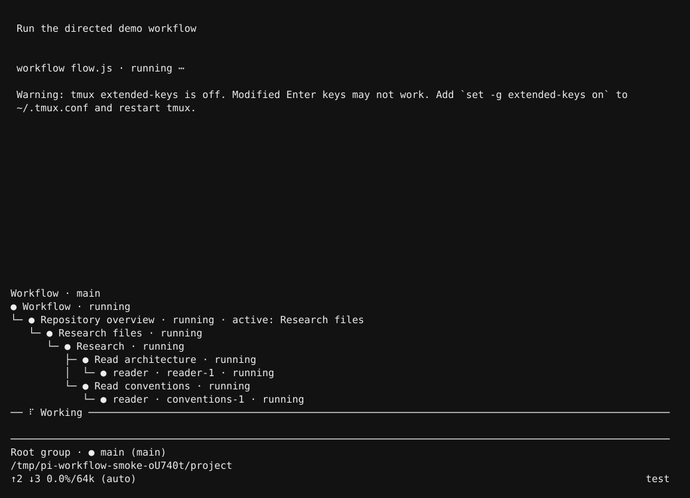

[Raw capture](artifacts/workflow-progress.txt). The bottom bar contains only `Root group · main` while two isolated workers run.

#### Group hierarchy

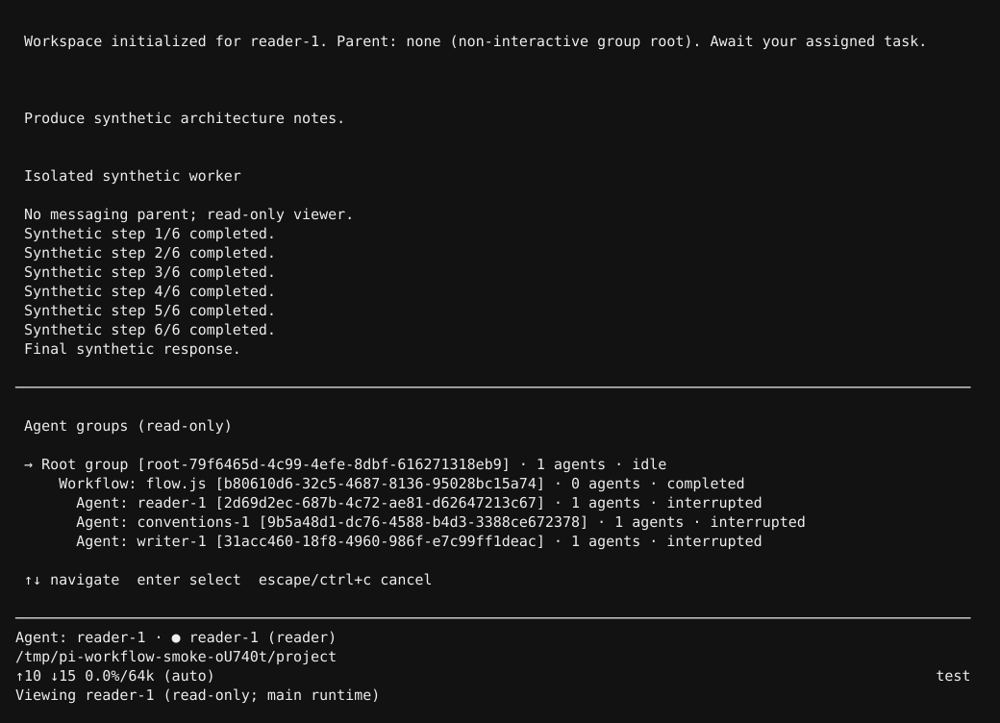

[Raw capture](artifacts/workflow-groups.txt).

#### Empty workflow container

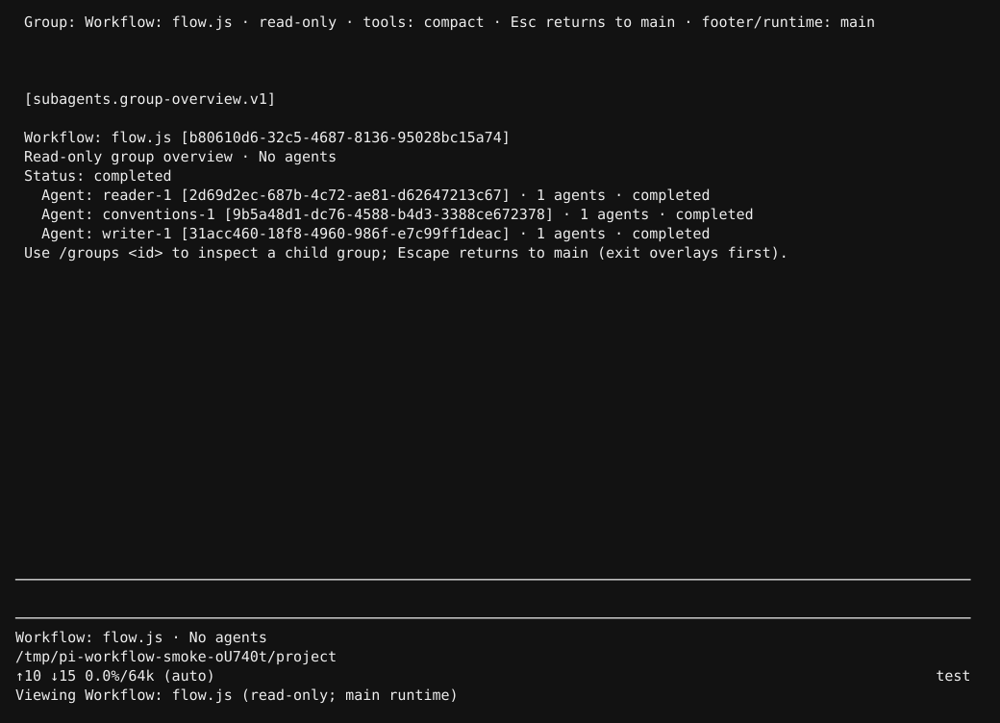

[Raw capture](artifacts/workflow-container.txt). This is a display-only overview, not a fabricated agent/session.

#### Isolated transcript and local agent picker

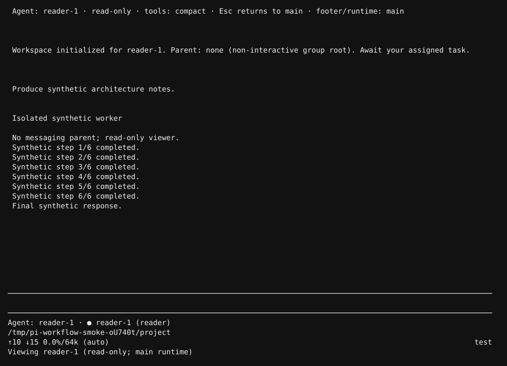

[Raw capture](artifacts/workflow-isolated-agent.txt).

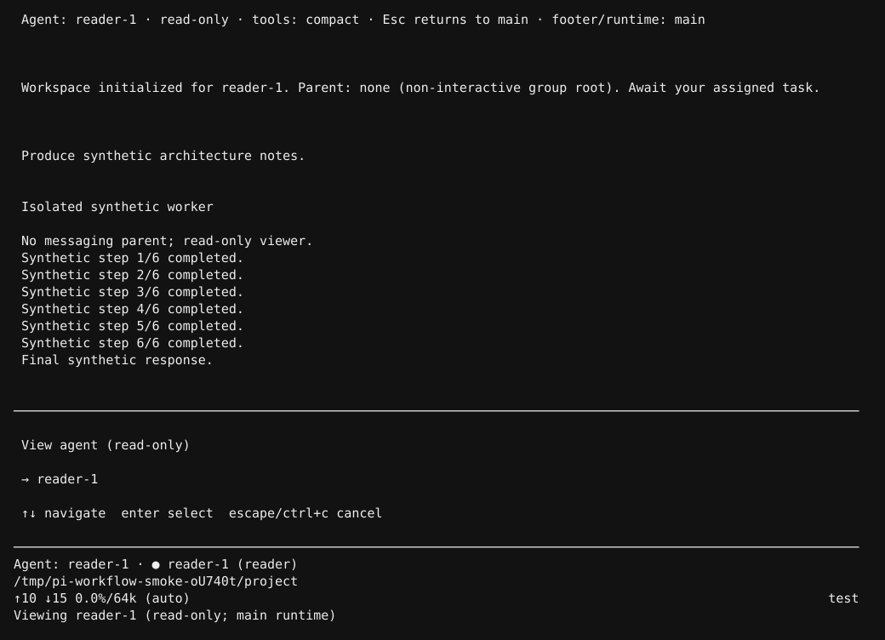

[Raw capture](artifacts/workflow-agent-picker.txt). No main or sibling-group agents appear.

#### Return to main and fallback

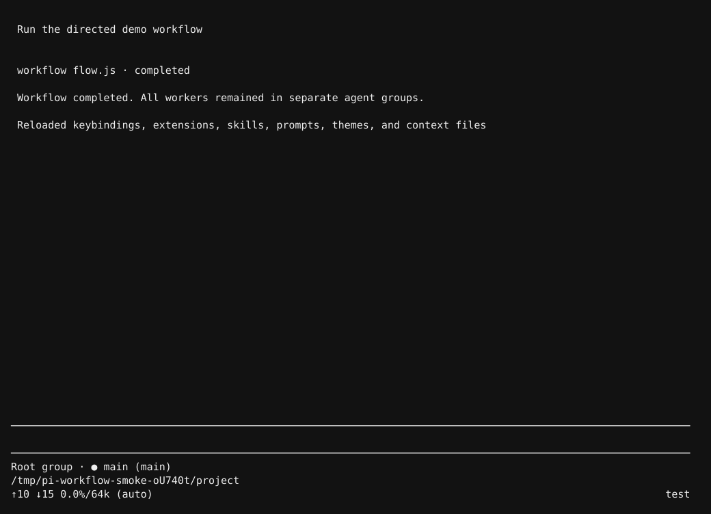

[Raw capture](artifacts/workflow-return-main.txt).

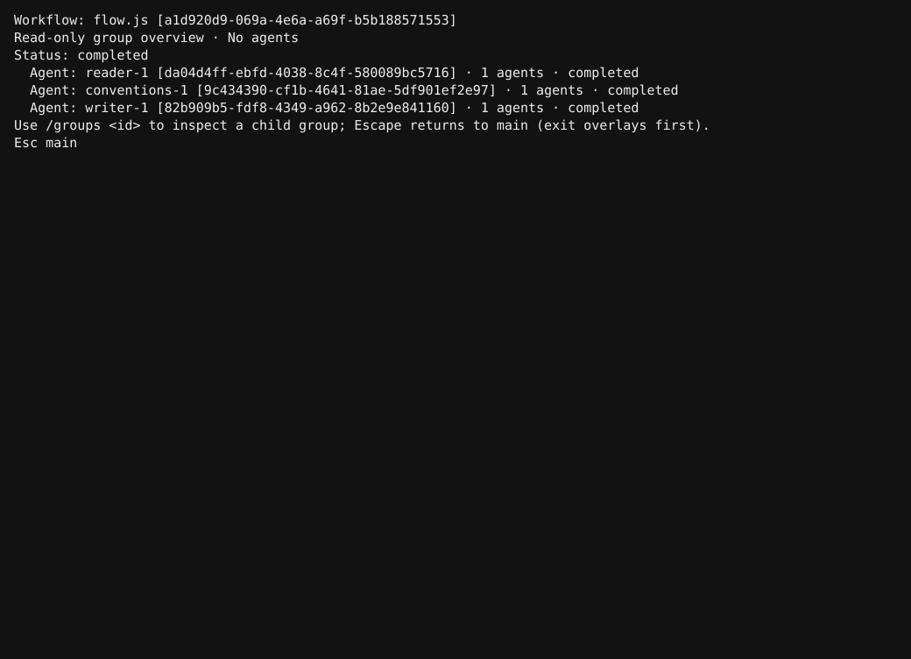

[Raw capture](artifacts/workflow-fallback.txt). The fallback fully covers unrelated main history; Escape exits it before entering another command.

The disposable Pi/tmux sessions were shut down after capture.

### Limitations

- Group/tool policy is not an OS sandbox: agents and trusted extensions share filesystem permissions and cwd. Already-completed file/tool side effects are not rolled back by cancellation.
- Crash recovery is not a cross-file exactly-once transaction. In-flight work is not resumed automatically; missing/corrupt new group provenance fails closed.
- Arbitrary pure JavaScript promises cannot be cooperatively stopped. Fail-fast waits for owned **host work** cleanup, not a forever-pending callback; cancelled facades reject further calls and final VM teardown ends execution.
- Shared-group workflow launches remain deliberately deferred. The workflow capability requires an active subagents workspace; direct recursive workflow calls are excluded from the script's tool catalog.
- Real paid/OAuth providers, live remote MCP/non-LLM model transports, provider-specific recovery, regular-mode visual terminal behavior, and non-Linux platforms were not end-to-end validated. Relevant host/adapter behaviors use local deterministic fixtures.

Run `/reload` to load the implementation. Invoke the workflow tool only when directed; `/groups` and `/subagents` are human, read-only navigation commands.

---

## Earlier subagents implementation (historical)

The record below describes the earlier implementation and its then-current paths/commands/test counts. Current extensions are under `pi/extensions`; `/agents` was subsequently renamed `/subagents`, and native viewing is now preferred over the fallback overlay.

## Changes made

Implemented `.pi/extensions/subagents/` for the installed Pi 1.1.0 host:

- Strict YAML agent templates, bundled main/leaf defaults, user/project/extra-path discovery, provenance, quarantine of malformed overrides, and project-trust gating.
- Independent model/thinking inheritance from parent or the user's global selection, resolved at creation and idle resume.
- Default/extra tool and skill loadouts; direct/nested tool restrictions; hidden leaf creation tools; bounded asynchronous MCP-name preflight.
- Named, persistent SDK worker sessions with workspace/parent identities, branch-relative membership, delivery IDs, idle restoration, compaction-compatible metadata, and ephemeral histories.
- `create_agent`, `send_message`, `wait_message`, and `list_agents`, all rejecting unknown argument fields.
- Steering delivery, idle-session resume, final-settlement parent reports, capacity/depth limits, wait cancellation/timeouts, and all-waiting deadlock refusal.
- `/agent` template selection and `/agents` read-only live transcript viewing, scrolling/cycling, tool expansion, and idle-agent grouping.
- Main-only extension filtering before worker factories run, plus explicit plan/goal role guards. Existing ordinary/headless behavior remains covered by regression tests.
- Explicit worker extension shutdown before session disposal, including cleanup of enhanced bash background processes.

Documentation: [extension README](../.pi/extensions/subagents/README.md). Approved design: [subagents plan](subagents.md).

### Implementation findings

1. **Viewer uses a full-screen overlay.** The originally planned non-overlay `ctx.ui.custom()` view let newly arriving main output appear above it during real terminal testing. A 100%-width/height overlay covers the visible frame without replacing the CLI session or stopping workers.
2. **Enhanced bash companions are retained with defaults.** Its tools register during `session_start`; the SDK's immutable selector must reserve `interact_bash`/`close_bash` names before binding. They remain unavailable when default tools are disabled unless explicitly requested.
3. **Pi flushes new sessions lazily.** A worker bootstrap user entry persists identity before acknowledging startup; the actual task is then supplied through the SDK.
4. **SDK and extension method names differ.** Worker selection uses `session.setActiveToolsByName()`, while extension selection uses `pi.setActiveTools()`. Tests check the installed declarations and runtime rather than relying on mocks alone.
5. **SDK disposal is not extension shutdown.** Workers explicitly emit shutdown events before disposal so extension-owned resources are released.

## What was tested

### Automated validation

```sh
npm --prefix .pi/extensions/subagents ci --ignore-scripts --legacy-peer-deps
npm --prefix .pi/extensions/subagents run check
node --test .pi/extensions/*/test.cjs .pi/extensions/*/*.test.cjs tests/pi-compatibility.cjs
```

Results:

- Dependency installation: successful; npm reported **0 vulnerabilities**.
- Strict TypeScript check against the installed Pi public declarations: **passed**.
- Repository-wide Node tests: **69 passed, 0 failed, 0 skipped**.
- `git diff --check`: **passed**.

The subagents suite includes real SDK sessions with a deterministic fake provider: separate JSONL files, startup acknowledgment before completion, idle resume, compaction/reopen, parallel wait/send delivery without duplicate context, permission errors, nested deferred-tool denial, defaults-disabled skill catalogs, inheritance on resume, capacity/depth limits, background-bash cleanup, ephemeral reconstruction, and delayed MCP-style registration. Root wiring tests cover template selection, leaf-to-main switching, reload, and new fork identities. Viewer tests cover scrolling, agent cycling, idle grouping, disposal, live updates, resize, narrow widths, Unicode, and terminal-sequence removal. Existing extensions' tests also passed.

No paid model calls were made.

### Terminal validation

Ran the real Pi TUI in a dedicated tmux server and disposable fake-provider project generated by `.pi/extensions/subagents/smoke.cjs`.

Verified:

- Main launched a worker asynchronously and waited for its message.
- `/agents` opened while work was running.
- Tab selected the worker and displayed incremental streaming output.
- The selected worker remained visible after becoming idle, while the idle count updated.
- Main received the worker's final output and continued.
- Escape restored the actual main conversation.
- `/new` produced a fresh workspace that could reuse the same worker name.
- The disposable Pi/tmux session was shut down afterward.

The following SVGs are **terminal text snapshots captured from that real TUI run**, converted from tmux pane captures. They demonstrate synthetic test work, not a live external provider. Raw text captures are retained beside them.

#### Running worker

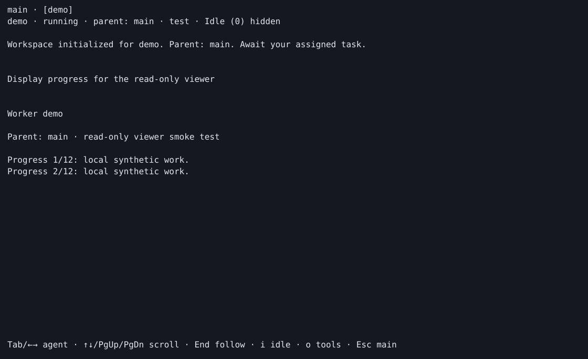

[Raw capture](artifacts/subagents-running.txt)

#### Retained idle worker

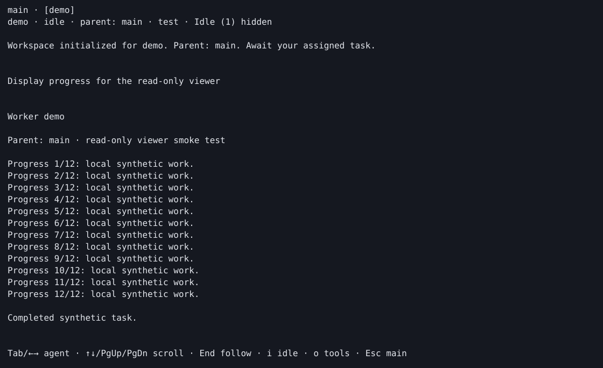

[Raw capture](artifacts/subagents-idle.txt)

#### Main receives completion

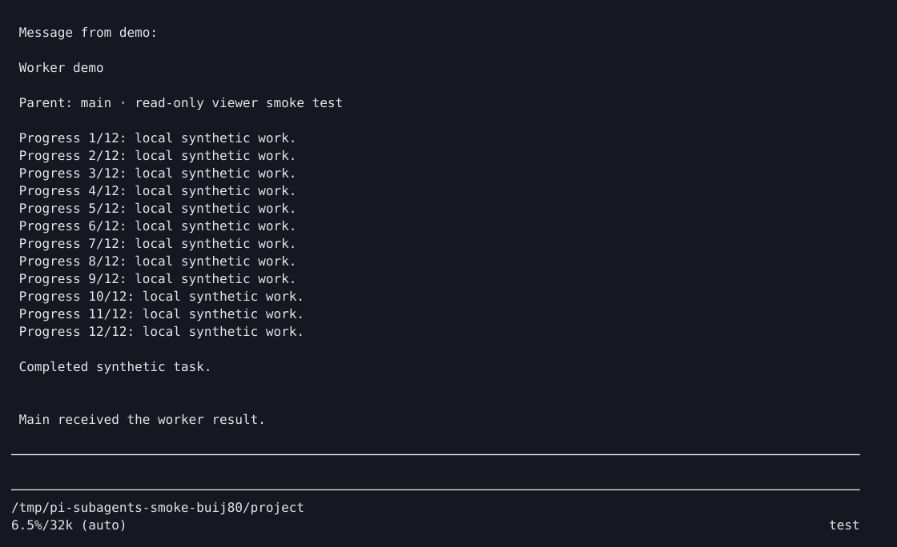

[Raw capture](artifacts/subagents-main.txt)

## Limitations and remaining validation

- Tool policy is not an OS sandbox; agents and trusted extensions share cwd/permissions.
- There is no generic Pi agent-resource API or cross-process workspace lock. Do not run two writers against the same worker files.
- `.pi/agents` alone does not trigger Pi's built-in trust prompt; definitions are skipped without an affirmative existing trust decision.
- Crash recovery is at-least-once, not a transactional exactly-once guarantee across session files.
- Main skill filtering cannot erase prior skill text or all existing skill commands. User image attachments currently show their accompanying text only in the viewer.
- Live OAuth/subscription providers, real MCP transports, provider-specific retry/overflow recovery, RPC clients, regular-mode terminal rendering, and Windows/macOS have **not** been end-to-end validated. Delayed tool registration is tested with a local synthetic extension, not a remote MCP server.

Run `/reload` in the main Pi instance to load the new extension, then use `/agent` or `/agents`.

## Server-side compaction

Implemented in `pi/extensions/server-side-compaction/`, without Pi core changes or new installed dependencies.

- `/compaction auto|pi|server|reset` selects the next backend per branch. Pi still owns manual/automatic/overflow triggers, cut points and unchanged recent-tail retention.
- Supported official OpenAI Responses/Codex adapters send only the original provider-normalized older prefix: full tool results, structured arguments, images, reasoning signatures and prior checkpoint bundles, not Pi's readable summarization prompt or truncated text.
- Persist and replay the complete ordered endpoint output, including preserved user messages. Endpoint/unsupported/budget failures fall back visibly to native readable compaction; cancellation does not start fallback.
- `/compaction portable` lazily reconstructs readable source context, saves a model-visible portable record, and works after disabling the extension. Incompatible interactive model switches offer conversion/cancel; headless workers never open dialogs or implicitly accept conversion cost.
- Request-time guards fail closed for stale/incompatible/corrupt checkpoints and concurrent conversion. The poison payload deliberately permits Promise `then` assimilation so Pi's fail-open hook runner cannot swallow the guard before provider serialization.
- Strict trusted configuration, refresh-safe credential lookup, bounded official-host requests, branch-local state and worker isolation are documented in the extension README.

### Validation

Deterministic installed-SDK tests cover endpoint/auth/limits, lossless prefix serialization (including a 12KB tool result), ordered replay, disk resume/sibling branches, native automatic threshold and overflow recovery, endpoint fallback, conversion error/cancellation, stale model authentication, missing portable anchors, routed-model rejection, and real subagents. Real OpenAI/Codex serializers are exercised with transport blocked.

```sh
node --test pi/extensions/server-side-compaction/test.cjs pi/extensions/server-side-compaction/*.test.cjs
node pi/extensions/server-side-compaction/check-types.cjs
npm --prefix pi/extensions/subagents run check
npm --prefix pi/extensions/workflow run check
node --test pi/extensions/*/test.cjs pi/extensions/*/*.test.cjs tests/*.cjs
git diff --check
```

Final results: **261/261 repository tests passed** (including **40 server-side-compaction tests**). Strict server-side-compaction, subagents and workflow type checks passed; `git diff --check` passed. No dependencies were installed and no paid model calls were made.

The obsolete `dynamic-workflows` skill discovery test was removed from `tests/pi-compatibility.cjs` at the user's request: the referenced skill is absent from this checkout. The remaining installed-host tests include loading the new extension and checking its commands/hooks.

### Real terminal evidence

A disposable tmux/Pi CLI session used only synthetic providers and a mocked compaction endpoint. Two prompts, `/compact`, then `/smoke-target` exercised the actual confirmation dialog. Escape retained `openai/smoke` with zero portable records; accept saved one readable portable record and selected `smoke-target/smoke`. The tmux server was stopped afterward. Reproduce the isolated fixture with `node pi/extensions/server-side-compaction/smoke.cjs`; no global configuration is changed.

These SVGs are **actual tmux pane text captures rendered as SVG**, not screenshots or evidence of a live external provider. Raw captures are adjacent.

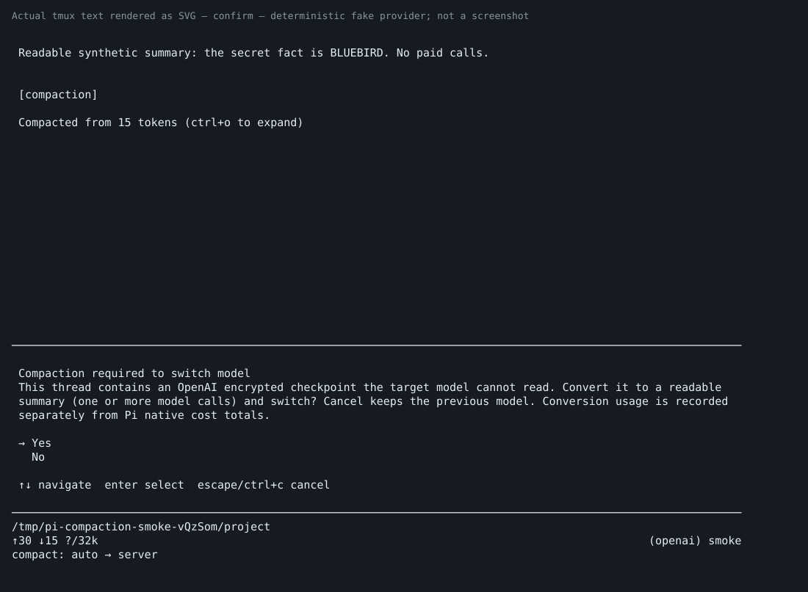

[Raw confirmation](artifacts/compaction-confirm.txt)

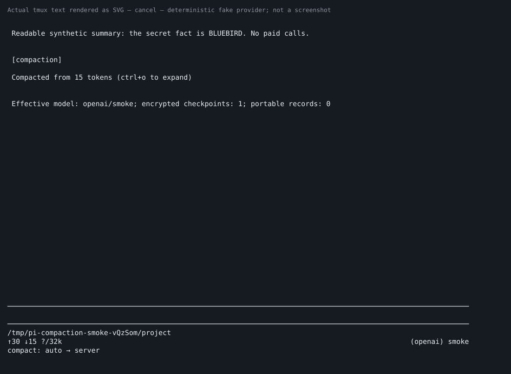

[Raw cancellation](artifacts/compaction-cancel.txt)

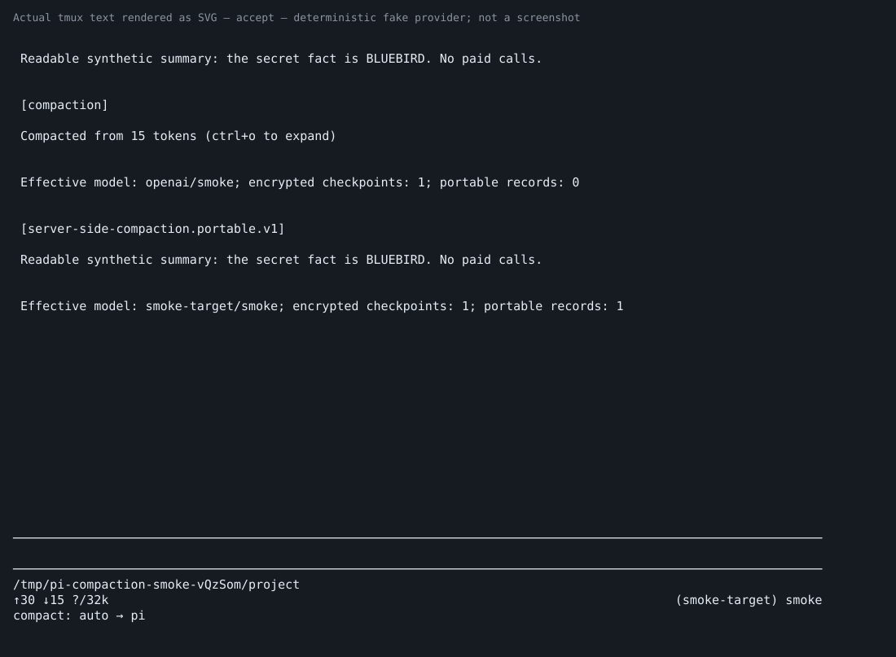

[Raw acceptance](artifacts/compaction-accept.txt)

### Explicit limitations

- No paid/live endpoint calls were made. Official API-key/Codex unary endpoint availability and cache reuse remain unverified; the newer Codex streamed compaction-trigger protocol is not implemented.
- Standalone portability/model-switch summary usage is stored once in `details.usage` with a notice, **not Pi native cost totals**, as explicitly approved. Regular compaction usage uses native `CompactionResult.usage`.
- Run `/compaction portable` **before disabling the extension**. Disabling without conversion loses the encrypted prefix from stock Pi's model context, although original session history remains on disk.
- Missing source anchors, modified/deleted portable records and indivisible oversized tool groups fail safely rather than inventing context. Third-party request transformations and transport overrides are not generally interchangeable with the official adapters.

### Footer follow-up

Replaced the separate compaction status line with a grey suffix beside the native model/effort: `server compaction (auto)`, `pi compaction (auto)`, `server compaction (override)`, or `pi compaction (override)`, separated by `•`. The reversible instance-only adapter preserves native cost/model/provider rows and other footer adapters, hides when padding is insufficient, and caches unchanged row transformations without repeatedly traversing conversation history.

**47/47** feature and installed-host compatibility tests passed, including footer labels, width, theme/content invalidation, unchanged frames, cleanup and adapter coexistence. Strict type check and diff check passed. A fresh disposable real Pi/tmux run confirmed `server compaction (auto)` at bottom right, then `/compaction pi` changed it to `pi compaction (override)` with no extra status row. [Raw terminal capture](artifacts/compaction-footer.txt). No live endpoint calls; tmux server stopped.
